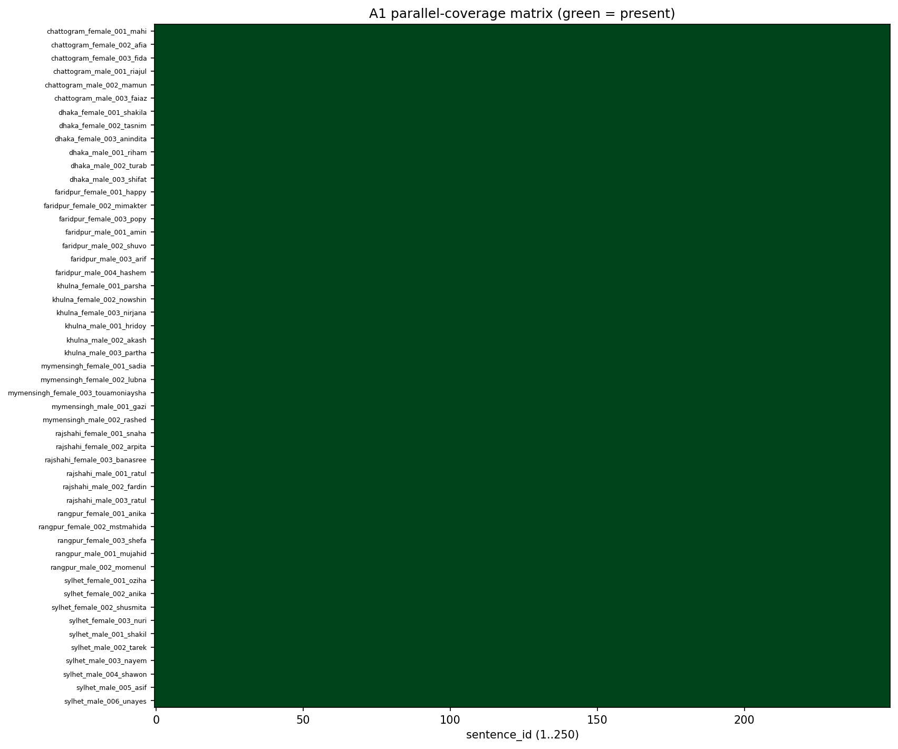

# A1 — Unique Sentences & Parallel Coverage

**Preprocessing:** Unicode NFC applied to all transcript text before counting.

## Headline numbers

- `sentences_in_csv` = 250
- `unique_sentence_texts` = 250
- `duplicate_text_rows` = 0
- `expected_sentences_per_speaker` = 250
- `n_speakers` = 51
- `n_regions` = 8
- `total_utterances` = 12750
- `expected_if_full_parallel` = 12750
- `speakers_complete` = 51
- `speakers_incomplete` = 0
- `total_missing_cells` = 0
- `fully_parallel` = True

## Interpretation

Every speaker has every sentence and there are no duplicate sentence texts — the corpus is fully parallel as designed.

## Per-speaker completeness

Full table: `per_speaker_completeness.csv`. Incomplete speakers (if any):

| note                  |
|:----------------------|
| all speakers complete |

## Coverage matrix

*Speaker x sentence presence (green = present).*
