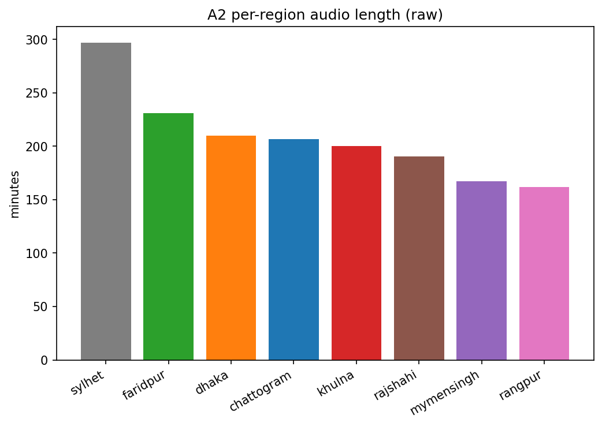
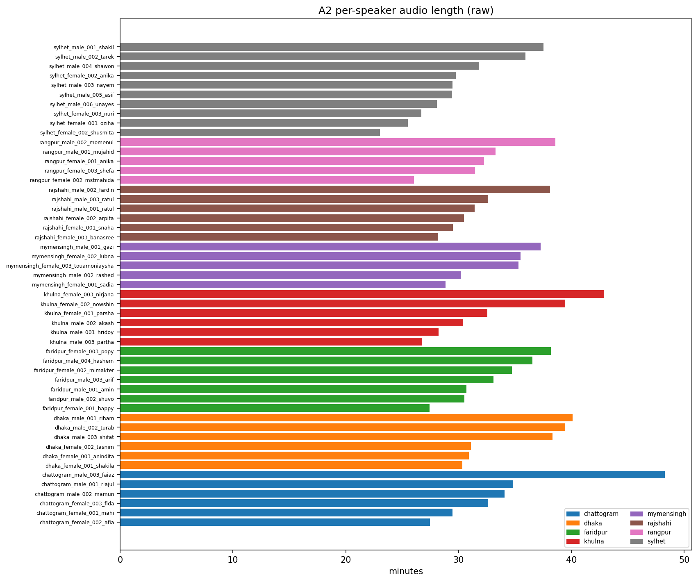

# A2 — Audio Length

**Duration mode:** `raw` (file-header duration, includes silence).

## Headline

- Total: **27h 44m 29s** (27.741 h) across 12750 utterances, 51 speakers, 8 regions.
- Mean utterance: 7.833 s. Speaker totals range 23.04–48.26 min.
## Per region

| region     |   total_s |   mean_s |   n_utt |   total_min |
|:-----------|----------:|---------:|--------:|------------:|
| sylhet     |   17830.8 |     7.13 |    2500 |      297.18 |
| faridpur   |   13868.2 |     7.92 |    1750 |      231.14 |
| dhaka      |   12612.2 |     8.41 |    1500 |      210.2  |
| chattogram |   12403   |     8.27 |    1500 |      206.72 |
| khulna     |   12017.2 |     8.01 |    1500 |      200.29 |
| rajshahi   |   11418.3 |     7.61 |    1500 |      190.3  |
| mymensingh |   10022.5 |     8.02 |    1250 |      167.04 |
| rangpur    |    9697   |     7.76 |    1250 |      161.62 |

## Per gender

| gender   |   total_s |   mean_s |   n_utt |
|:---------|----------:|---------:|--------:|
| female   |   46774.1 |     7.48 |    6250 |
| male     |   53095.1 |     8.17 |    6500 |

## Region x gender (minutes)

| region     |   female |   male |
|:-----------|---------:|-------:|
| chattogram |    89.53 | 117.18 |
| dhaka      |    92.33 | 117.87 |
| faridpur   |   100.31 | 130.83 |
| khulna     |   114.89 |  85.39 |
| mymensingh |    99.61 |  67.44 |
| rajshahi   |    88.16 | 102.14 |
| rangpur    |    89.78 |  71.84 |
| sylhet     |   104.96 | 192.22 |

## Figures

*Total audio per region.*

*Total audio per speaker (colored by region).*

## Look for

Speakers or regions with markedly less audio — imbalance worsens the speaker–accent confound. Full table: `per_speaker_duration.csv`.
