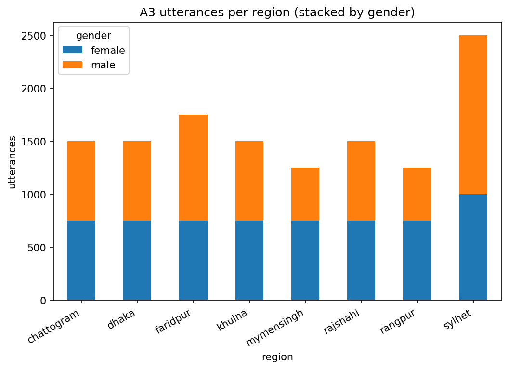

# A3 — Utterance Counts

## Headline

- Total utterances: **12750** (51 speakers x up to 250 sentences).
- Speakers below expected: 0; above: 0.
## Speakers per region

| region     |   n_speakers |
|:-----------|-------------:|
| chattogram |            6 |
| dhaka      |            6 |
| faridpur   |            7 |
| khulna     |            6 |
| mymensingh |            5 |
| rajshahi   |            6 |
| rangpur    |            5 |
| sylhet     |           10 |

## Utterances per region

| region     |   n_utt |
|:-----------|--------:|
| sylhet     |    2500 |
| faridpur   |    1750 |
| dhaka      |    1500 |
| chattogram |    1500 |
| khulna     |    1500 |
| rajshahi   |    1500 |
| mymensingh |    1250 |
| rangpur    |    1250 |

## Region x gender

| region     |   female |   male |
|:-----------|---------:|-------:|
| chattogram |      750 |    750 |
| dhaka      |      750 |    750 |
| faridpur   |      750 |   1000 |
| khulna     |      750 |    750 |
| mymensingh |      750 |    500 |
| rajshahi   |      750 |    750 |
| rangpur    |      750 |    500 |
| sylhet     |     1000 |   1500 |

*Utterances per region, stacked by gender.*

## Look for

Uneven counts across regions, and speakers whose `delta_vs_expected` is non-zero (see `per_speaker_counts.csv`).
