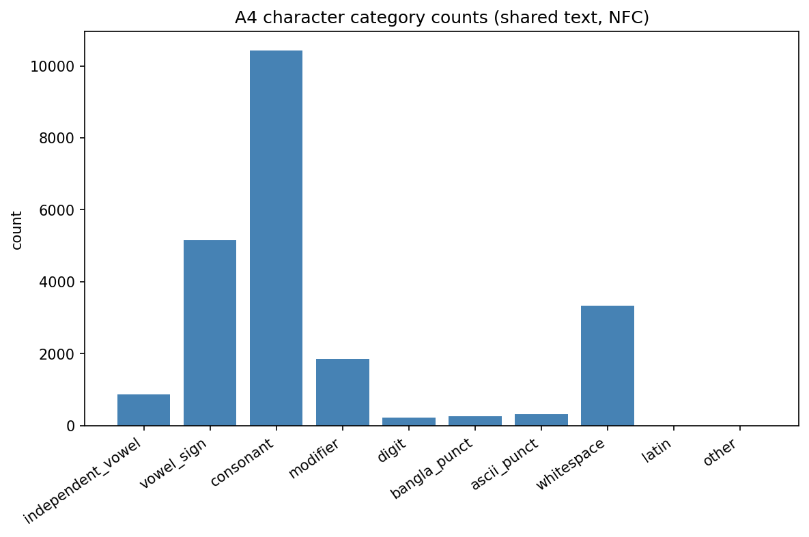
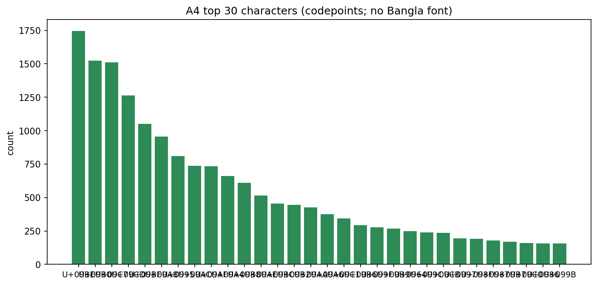

# A4 — Character Count (Vowel / Consonant)

**Preprocessing:** NFC. Counts at the Unicode code-point level. Vowels = independent vowels + dependent vowel signs (kar); consonants = consonant letters; hasanta/nukta/anusvara/visarga/chandrabindu = modifiers.

_Computed once on the shared sentence set; identical across all regions._

## Headline

- Sentences: 250
- Non-space code points: 19113; grapheme clusters: 10844
- Vowels: 6026; consonants: 10435; V/C ratio: 0.5775
- Unique characters: 81
## Category breakdown

| category          |   count |   pct_of_nonspace |
|:------------------|--------:|------------------:|
| independent_vowel |     874 |              4.57 |
| vowel_sign        |    5152 |             26.96 |
| consonant         |   10435 |             54.6  |
| modifier          |    1860 |              9.73 |
| digit             |     221 |              1.16 |
| bangla_punct      |     250 |              1.31 |
| ascii_punct       |     320 |              1.67 |
| whitespace        |    3341 |             17.48 |
| latin             |       1 |              0.01 |
| other             |       0 |              0    |

## Figures

*Character categories.*

*Top 30 characters by frequency.*

> Note: no Bangla-capable font found; figure labels fall back to code points. Exact characters are in `char_frequency.csv`.
