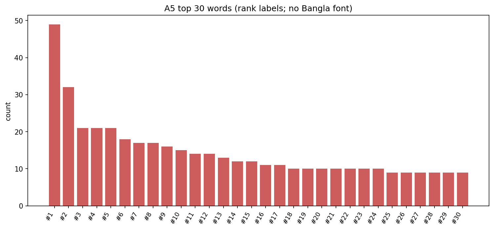
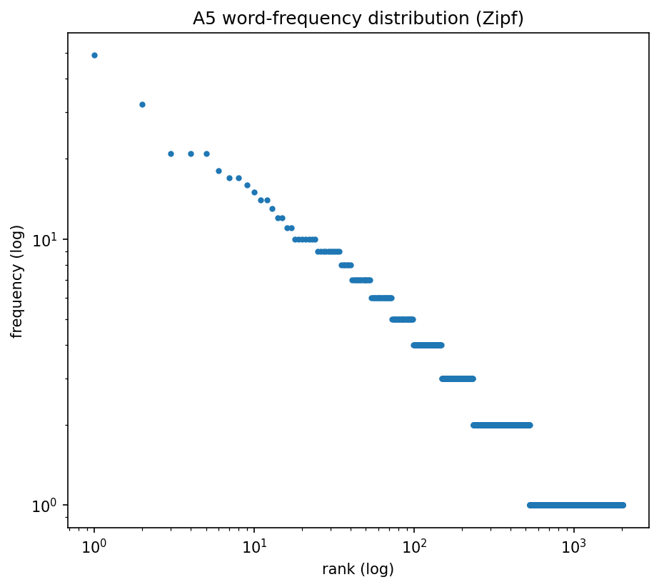

# A5 — Word Count & Frequency

**Preprocessing:** NFC; whitespace tokenizer after stripping danda/punctuation.

_Computed once on the shared sentence set; identical across all regions._

## Headline

- Total tokens: **3385**; unique types: **2012**; TTR: 0.5944.
- Hapax legomena (count==1): 1485.
- Words/sentence: mean 13.54 (min 2, max 122).
## Top words

Full table: `word_frequency.csv`. Top 20:

|   rank | word   |   count |   pct |
|-------:|:-------|--------:|------:|
|      1 | ও      |      49 | 1.448 |
|      2 | করে    |      32 | 0.945 |
|      3 | এই     |      21 | 0.62  |
|      4 | এ      |      21 | 0.62  |
|      5 | এবং    |      21 | 0.62  |
|      6 | হয়    |      18 | 0.532 |
|      7 | থেকে   |      17 | 0.502 |
|      8 | না     |      17 | 0.502 |
|      9 | বলেন   |      16 | 0.473 |
|     10 | হয়ে   |      15 | 0.443 |
|     11 | জন্য   |      14 | 0.414 |
|     12 | সঙ্গে  |      14 | 0.414 |
|     13 | করেন   |      13 | 0.384 |
|     14 | বেশি   |      12 | 0.355 |
|     15 | আর     |      12 | 0.355 |
|     16 | করা    |      11 | 0.325 |
|     17 | দিয়ে  |      11 | 0.325 |
|     18 | কিছু   |      10 | 0.295 |
|     19 | এর     |      10 | 0.295 |
|     20 | টা     |      10 | 0.295 |

## Figures

*Top 30 words by frequency.*

*Rank-frequency (Zipf) distribution.*

> Note: no Bangla-capable font found; top-words figure uses rank labels. Exact words are in `word_frequency.csv`.
