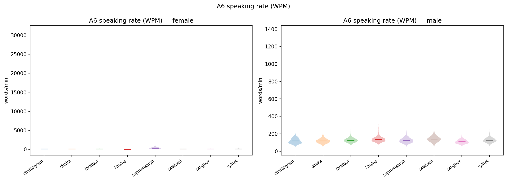
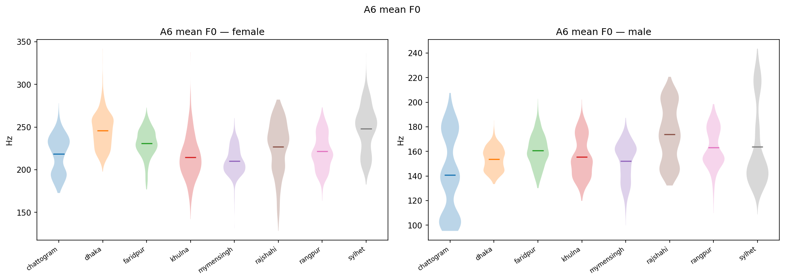

# A6 — Speaking Rate & Pitch (F0)

**Preprocessing:** WPM uses speech-only duration (silence trimmed, top_db=30); F0 uses per-gender floor/ceiling {'male': (75, 300), 'female': (100, 500)}.

## Headline

- Utterances analyzed: 12750.
- Overall mean WPM: 125.31; mean syllables/s: 6.303.
## Per region x gender

| region     | gender   |   wpm_mean |   wpm_std |   syll_per_s_mean |   syll_per_s_std |   speech_dur_s_mean |   f0_mean_mean |   f0_mean_std |
|:-----------|:---------|-----------:|----------:|------------------:|-----------------:|--------------------:|---------------:|--------------:|
| chattogram | female   |     125.27 |     21.95 |              6.28 |             1.01 |                6.68 |         218.55 |         21.96 |
| chattogram | male     |     117.59 |     30.63 |              5.89 |             1.46 |                7.46 |         140.8  |         32.28 |
| dhaka      | female   |     113.34 |     20.7  |              5.7  |             1.1  |                7.15 |         245.82 |         20.16 |
| dhaka      | male     |     118.02 |     27.9  |              5.91 |             1.31 |                7.34 |         153.71 |          9.36 |
| faridpur   | female   |     108.28 |     56.87 |              5.42 |             2.28 |                7.8  |         230.86 |         16.79 |
| faridpur   | male     |     126.11 |     24.59 |              6.32 |             1.13 |                6.83 |         160.72 |         12.82 |
| khulna     | female   |      91.95 |     22.36 |              4.63 |             1.14 |                8.88 |         214.47 |         24.59 |
| khulna     | male     |     135.54 |     28.94 |              6.79 |             1.34 |                6.38 |         155.5  |         16.34 |
| mymensingh | female   |     166.05 |   1204.55 |              8.62 |            70.27 |                7.63 |         210.35 |         16    |
| mymensingh | male     |     124.5  |     29.16 |              6.23 |             1.33 |                7.02 |         152.01 |         15.7  |
| rajshahi   | female   |     120.23 |     34.74 |              6.05 |             1.8  |                6.94 |         226.95 |         30.72 |
| rajshahi   | male     |     142.22 |     60.67 |              7.14 |             2.94 |                6.05 |         173.76 |         23.11 |
| rangpur    | female   |     124.24 |     30.63 |              6.24 |             1.43 |                6.73 |         221.47 |         20.73 |
| rangpur    | male     |     110.47 |     23.88 |              5.54 |             1.15 |                7.79 |         163.03 |         16.06 |
| sylhet     | female   |     141.61 |     37.57 |              7.11 |             1.87 |                5.83 |         248.03 |         26.98 |
| sylhet     | male     |     126.95 |     26.04 |              6.37 |             1.26 |                6.76 |         163.67 |         32.68 |

## Figures

*Speaking rate (WPM) by region, faceted by gender.*

*Mean F0 by region, faceted by gender.*

## Critical caveat

F0 is dominated by gender (male ≈ low, female ≈ high). **Read F0 region effects *within* each gender panel** — a pooled per-region F0 mean mostly reflects the male/female ratio. Per-utterance values: `utterance_metrics.csv`.
