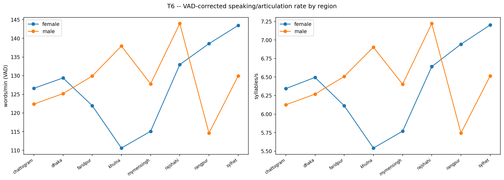
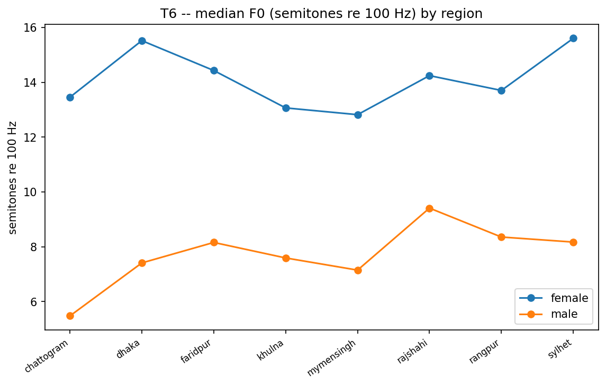

# T6 -- VAD-Based Speaking Rate

A6's `librosa.effects.trim(top_db=30)` speech-duration heuristic explodes on quiet recordings (WPM up to ~31,000 in that table). This replaces it with Silero VAD and excludes implausible cells from the aggregates instead of silently keeping them: **239/12747** utterances (1.875%) are excluded (short speech / bad speech ratio / WPM outside [60, 400]). Overall mean WPM (VAD, cleaned): **128.82** (median 126.32).

## Headline numbers

- `n_utterances_in` = 12747
- `n_utterances_used` = 12508
- `n_excluded_from_agg` = 239
- `pct_excluded` = 1.875
- `overall_wpm_mean` = 128.82
- `overall_wpm_median` = 126.32
- `overall_articulation_rate_mean` = 6.455
## Excluded outliers, by region x gender x reason

| region     | gender   | exclude_reason                                  |   n |
|:-----------|:---------|:------------------------------------------------|----:|
| khulna     | male     | bad_speech_ratio;                               |  66 |
| rajshahi   | female   | bad_speech_ratio;                               |  61 |
| faridpur   | female   | bad_speech_ratio;                               |  17 |
| rangpur    | male     | bad_speech_ratio;                               |  16 |
| chattogram | female   | bad_speech_ratio;                               |  15 |
| sylhet     | male     | bad_speech_ratio;                               |  14 |
| rangpur    | female   | bad_speech_ratio;                               |  10 |
| dhaka      | female   | bad_speech_ratio;                               |   9 |
| faridpur   | male     | bad_speech_ratio;                               |   7 |
| mymensingh | female   | bad_speech_ratio;                               |   6 |
| sylhet     | female   | bad_speech_ratio;                               |   5 |
| chattogram | male     | bad_speech_ratio;                               |   3 |
| khulna     | female   | wpm_out_of_range;                               |   2 |
| sylhet     | female   | wpm_out_of_range;                               |   2 |
| khulna     | female   | short_speech;bad_speech_ratio;wpm_out_of_range; |   1 |
| rajshahi   | male     | bad_speech_ratio;                               |   1 |
| rangpur    | female   | wpm_out_of_range;                               |   1 |
| sylhet     | female   | bad_speech_ratio;wpm_out_of_range;              |   1 |
| sylhet     | female   | short_speech;bad_speech_ratio;wpm_out_of_range; |   1 |
| rajshahi   | female   | short_speech;bad_speech_ratio;wpm_out_of_range; |   1 |

## Before / after: A6 (top_db=30) vs. T6 (VAD)

Overall mean WPM dropped -6.11% after switching to VAD + guards -- direct evidence the old energy-trim heuristic was inflating WPM.

| region     | gender   |   wpm_new_vad_mean |   wpm_old_topdb30_mean |   wpm_new_vad_median |   wpm_old_topdb30_median |   wpm_mean_reduction_pct |
|:-----------|:---------|-------------------:|-----------------------:|---------------------:|-------------------------:|-------------------------:|
| chattogram | female   |             126.61 |                 125.33 |               124.64 |                   124.21 |                    -1.03 |
| chattogram | male     |             122.38 |                 117.52 |               119.21 |                   112.85 |                    -4.13 |
| dhaka      | female   |             129.39 |                 113.22 |               128.21 |                   113.22 |                   -14.28 |
| dhaka      | male     |             125.2  |                 118.02 |               122.78 |                   116.63 |                    -6.09 |
| faridpur   | female   |             121.97 |                 105.87 |               120    |                   103.09 |                   -15.21 |
| faridpur   | male     |             129.9  |                 126.01 |               128.57 |                   125    |                    -3.09 |
| khulna     | female   |             110.61 |                  91.64 |               109.86 |                    91.15 |                   -20.69 |
| khulna     | male     |             137.94 |                 133.7  |               134.48 |                   129.73 |                    -3.17 |
| mymensingh | female   |             115.1  |                 109.25 |               115.18 |                   107.75 |                    -5.35 |
| mymensingh | male     |             127.81 |                 124.5  |               124.76 |                   121.45 |                    -2.65 |
| rajshahi   | female   |             132.97 |                 118.79 |               130.43 |                   117.28 |                   -11.94 |
| rajshahi   | male     |             143.96 |                 142.31 |               141.18 |                   137.5  |                    -1.16 |
| rangpur    | female   |             138.58 |                 123.42 |               136.36 |                   121.27 |                   -12.28 |
| rangpur    | male     |             114.62 |                 110.28 |               111.7  |                   108.08 |                    -3.94 |
| sylhet     | female   |             143.45 |                 140.24 |               140    |                   136.81 |                    -2.29 |
| sylhet     | male     |             129.94 |                 126.84 |               127.66 |                   124.54 |                    -2.45 |

## Per region x gender (VAD-corrected)

| region     | gender   |   wpm_mean |   wpm_std |   wpm_median |   articulation_rate_sps_mean |   articulation_rate_sps_std |   speech_dur_s_mean |   speech_ratio_mean |   f0_mean_mean |   f0_mean_std |   f0_semitone_re100_mean |   f0_semitone_re100_std |
|:-----------|:---------|-----------:|----------:|-------------:|-----------------------------:|----------------------------:|--------------------:|--------------------:|---------------:|--------------:|-------------------------:|------------------------:|
| chattogram | female   |    126.615 |    21.158 |      124.64  |                        6.344 |                       0.966 |               6.535 |               0.905 |        218.709 |        22.046 |                   13.458 |                   1.775 |
| chattogram | male     |    122.379 |    28.099 |      119.205 |                        6.126 |                       1.305 |               7.02  |               0.727 |        140.936 |        32.279 |                    5.476 |                   4.036 |
| dhaka      | female   |    129.388 |    22.767 |      128.205 |                        6.495 |                       1.133 |               6.441 |               0.843 |        245.966 |        20.067 |                   15.524 |                   1.404 |
| dhaka      | male     |    125.198 |    24.487 |      122.781 |                        6.269 |                       1.118 |               6.77  |               0.684 |        153.713 |         9.354 |                    7.411 |                   1.053 |
| faridpur   | female   |    121.97  |    22.675 |      120     |                        6.113 |                       1.062 |               6.814 |               0.834 |        230.82  |        16.722 |                   14.434 |                   1.289 |
| faridpur   | male     |    129.905 |    22.912 |      128.571 |                        6.507 |                       1.026 |               6.492 |               0.807 |        160.711 |        12.82  |                    8.158 |                   1.384 |
| khulna     | female   |    110.608 |    21.859 |      109.859 |                        5.542 |                       1.012 |               7.625 |               0.802 |        214.082 |        24.088 |                   13.069 |                   1.95  |
| khulna     | male     |    137.936 |    25.253 |      134.483 |                        6.903 |                       1.161 |               6.245 |               0.879 |        155.911 |        16.527 |                    7.592 |                   1.825 |
| mymensingh | female   |    115.098 |    18.938 |      115.182 |                        5.769 |                       0.883 |               7.214 |               0.893 |        210.343 |        16.046 |                   12.822 |                   1.331 |
| mymensingh | male     |    127.807 |    25.716 |      124.764 |                        6.403 |                       1.179 |               6.649 |               0.803 |        151.968 |        15.695 |                    7.148 |                   1.856 |
| rajshahi   | female   |    132.97  |    23.606 |      130.435 |                        6.641 |                       1.123 |               6.224 |               0.872 |        229.848 |        29.859 |                   14.247 |                   2.426 |
| rajshahi   | male     |    143.96  |    25.411 |      141.176 |                        7.221 |                       1.192 |               5.823 |               0.677 |        173.776 |        23.141 |                    9.412 |                   2.326 |
| rangpur    | female   |    138.577 |    23.356 |      136.364 |                        6.943 |                       1.045 |               6.051 |               0.821 |        221.681 |        20.766 |                   13.706 |                   1.626 |
| rangpur    | male     |    114.622 |    22.91  |      111.696 |                        5.745 |                       1.091 |               7.45  |               0.844 |        162.826 |        15.979 |                    8.356 |                   1.714 |
| sylhet     | female   |    143.45  |    31.63  |      140     |                        7.202 |                       1.525 |               5.662 |               0.896 |        247.847 |        27     |                   15.608 |                   1.921 |
| sylhet     | male     |    129.939 |    23.946 |      127.66  |                        6.515 |                       1.146 |               6.523 |               0.825 |        163.256 |        32.431 |                    8.172 |                   3.227 |

## Figures

*VAD-corrected WPM and articulation rate by region.*

*Median F0 (semitones re 100 Hz) by region.*

## For the paper

S4 corpus statistics: this table replaces thesis Table 4.4. Cite `method_comparison.csv` as evidence for the correction, and `overall_articulation_rate_mean` (syllables/s) as the more cross-study-comparable rate metric alongside WPM.
