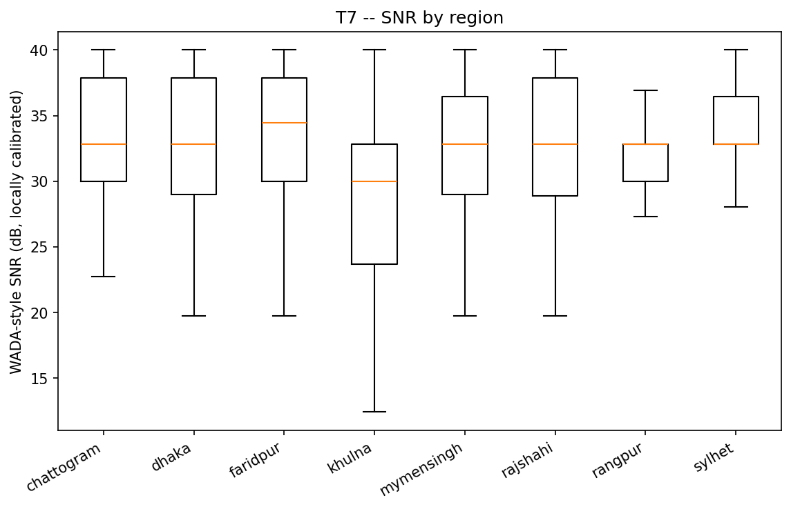
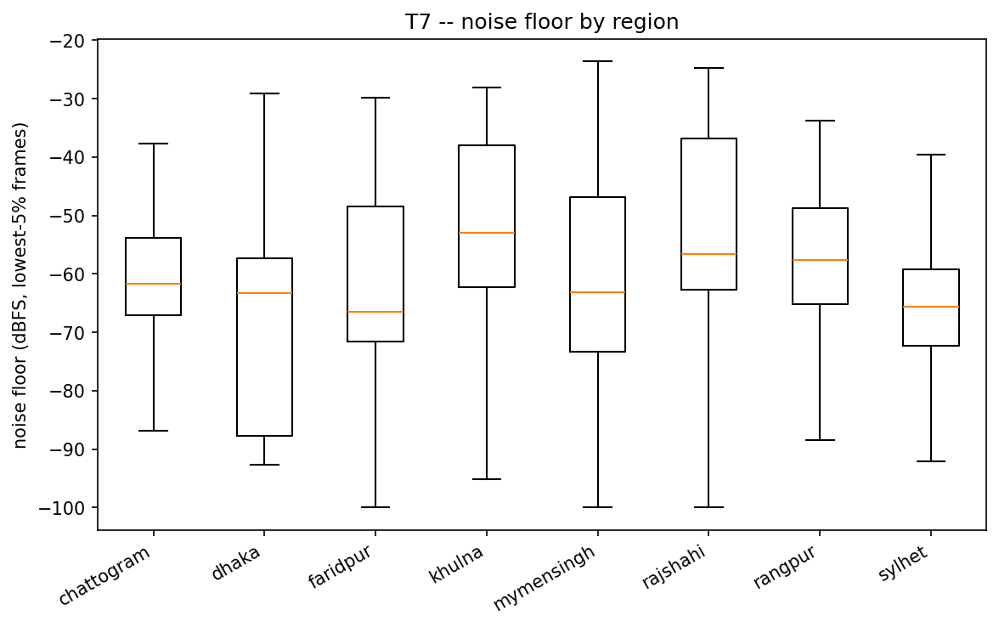
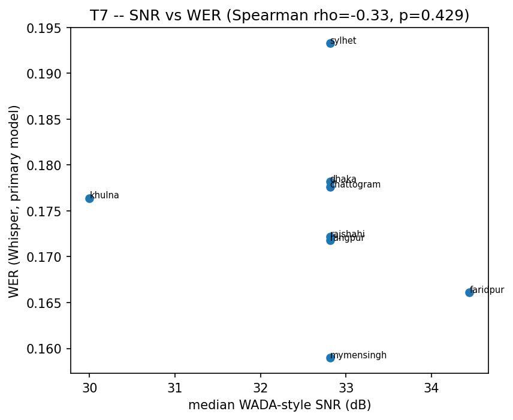

# T7 -- SNR Estimator & Quality Audit

check_audio_quality.py's existing `snr_db` = 90th-percentile 25ms-frame RMS(dB) minus 10th-percentile 25ms-frame RMS(dB) -- an ad-hoc percentile-loudness-ratio heuristic, not a published/named method. This adds a **named, documented WADA-style SNR estimator** (Kim & Stern 2008 log-amplitude-Gamma statistic, locally calibrated against synthetic known-SNR mixtures built from this corpus's own clips -- calibration fit R^2=0.808; see `bpac_eda/snr.py` docstring for exactly what deviates from the original paper) plus a noise-floor measure.

## Headline numbers

- `overall_wada_snr_median` = 32.81
- `overall_noise_floor_median` = -61.78
- `kruskal_wallis_H` = 1081.1114247261078
- `kruskal_wallis_p` = 3.5659182463008976e-229
- `kruskal_wallis_epsilon_squared` = 0.08431677719806169
## Does SNR differ by region?

Kruskal-Wallis H=1081.11, p=3.57e-229, epsilon-squared=0.0843 (effect size: 0=no effect, 1=region fully determines SNR rank). 

## Region x pipeline (== gender, invariant 3 -- cannot separate the two)

Lab (male) vs. app (female) recordings cannot be compared independently of gender.

| region     | pipeline   |    n |   wada_snr_med |   noise_floor_med |
|:-----------|:-----------|-----:|---------------:|------------------:|
| chattogram | app        |  750 |          32.81 |            -59.47 |
| chattogram | lab        |  750 |          36.43 |            -64.04 |
| dhaka      | app        |  750 |          29    |            -87.74 |
| dhaka      | lab        |  750 |          37.86 |            -62.55 |
| faridpur   | app        |  749 |          28.88 |            -46.35 |
| faridpur   | lab        | 1000 |          37.35 |            -69.15 |
| khulna     | app        |  750 |          23.69 |            -37.9  |
| khulna     | lab        |  750 |          32.73 |            -56.51 |
| mymensingh | app        |  748 |          30    |            -50.91 |
| mymensingh | lab        |  500 |          36.43 |            -64.82 |
| rajshahi   | app        |  750 |          28.88 |            -36.82 |
| rajshahi   | lab        |  750 |          37.86 |            -61.9  |
| rangpur    | app        |  750 |          32.73 |            -49.85 |
| rangpur    | lab        |  500 |          32.81 |            -62.37 |
| sylhet     | app        | 1000 |          32.81 |            -79.56 |
| sylhet     | lab        | 1500 |          34.44 |            -64.78 |

## Does noise explain the per-region WER differences?

Spearman rho=-0.327 (p=0.429) between median WADA-SNR and per-region Whisper WER, across 8 regions. Weak/non-significant correlation -- SNR does **not** explain per-region WER differences, strengthening the case that WER differences reflect accent, not audio quality.

| region     |    n |   wada_snr_med |   old_snr_med |   noise_floor_med |   rms_dbfs_med |   clip_pct_med |   WER |
|:-----------|-----:|---------------:|--------------:|------------------:|---------------:|---------------:|------:|
| chattogram | 1500 |         32.812 |        39.823 |           -61.625 |        -19.028 |              0 | 0.178 |
| dhaka      | 1500 |         32.812 |        42.787 |           -63.341 |        -16.788 |              0 | 0.178 |
| faridpur   | 1749 |         34.444 |        46.069 |           -66.466 |        -17.943 |              0 | 0.166 |
| khulna     | 1500 |         30     |        32.44  |           -52.951 |        -18.498 |              0 | 0.176 |
| mymensingh | 1248 |         32.812 |        31.844 |           -63.189 |        -18.213 |              0 | 0.159 |
| rajshahi   | 1500 |         32.812 |        38.53  |           -56.599 |        -16.315 |              0 | 0.172 |
| rangpur    | 1250 |         32.812 |        31.715 |           -57.548 |        -18.352 |              0 | 0.172 |
| sylhet     | 2500 |         32.812 |        43.761 |           -65.583 |        -17.501 |              0 | 0.193 |

## Per-region summary

| region     |    n |   wada_snr_med |   old_snr_med |   noise_floor_med |   rms_dbfs_med |   clip_pct_med |
|:-----------|-----:|---------------:|--------------:|------------------:|---------------:|---------------:|
| chattogram | 1500 |          32.81 |         39.82 |            -61.63 |         -19.03 |              0 |
| dhaka      | 1500 |          32.81 |         42.79 |            -63.34 |         -16.79 |              0 |
| faridpur   | 1749 |          34.44 |         46.07 |            -66.47 |         -17.94 |              0 |
| khulna     | 1500 |          30    |         32.44 |            -52.95 |         -18.5  |              0 |
| mymensingh | 1248 |          32.81 |         31.84 |            -63.19 |         -18.21 |              0 |
| rajshahi   | 1500 |          32.81 |         38.53 |            -56.6  |         -16.32 |              0 |
| rangpur    | 1250 |          32.81 |         31.71 |            -57.55 |         -18.35 |              0 |
| sylhet     | 2500 |          32.81 |         43.76 |            -65.58 |         -17.5  |              0 |

## Figures

*WADA-style SNR by region.*

*Noise floor by region.*

*SNR vs. WER scatter, the evidence for/against the noise-explains-WER claim.*

## For the paper

S5.1 quality audit: `snr_vs_wer_scatter` is the figure that rules out (or flags) noise as the WER explanation. Report the WADA-style estimator by name, with the calibration caveat above -- do not call it 'the WADA-SNR from Kim & Stern (2008)' without qualification.
