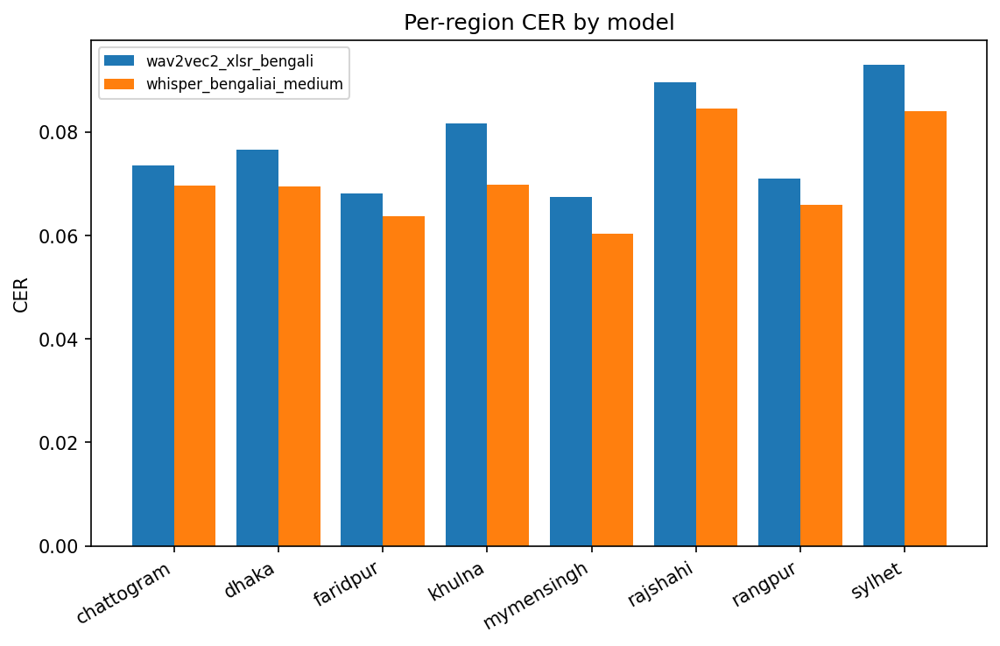
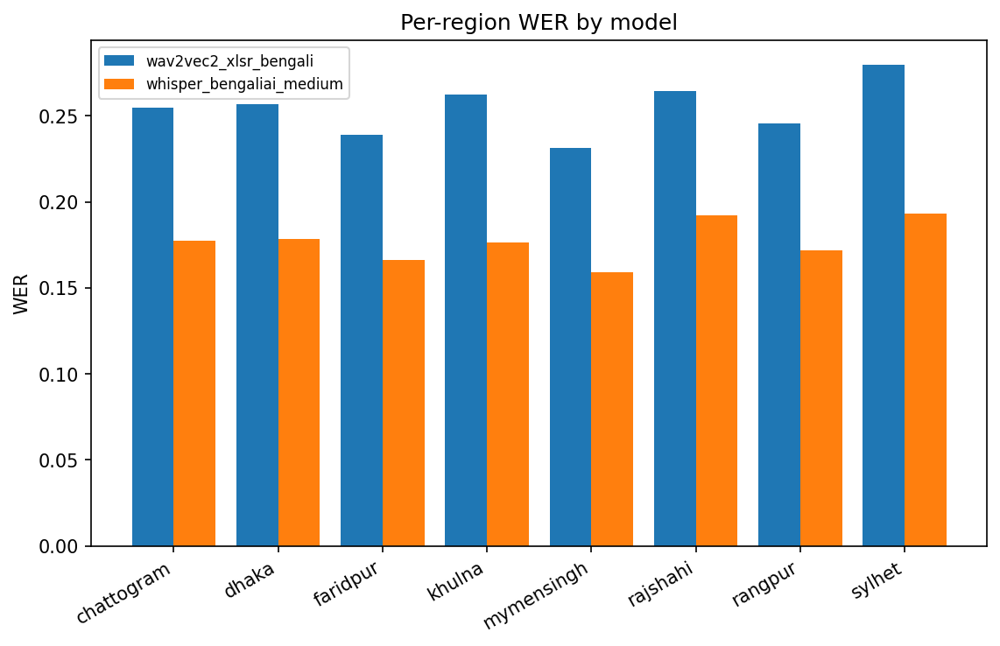

# Combined STT Report

Models present in cache: **whisper_bengaliai_medium, wav2vec2_xlsr_bengali**. Empty-audio utterances excluded from scoring.

## Whole-corpus comparison

| model_key                | label                       | type         |    WER |    CER |   n_scored |   n_excluded_empty |
|:-------------------------|:----------------------------|:-------------|-------:|-------:|-----------:|-------------------:|
| whisper_bengaliai_medium | Whisper-medium (Bengali.AI) | whisper      | 0.1784 | 0.0722 |      12747 |                  3 |
| wav2vec2_xlsr_bengali    | XLS-R wav2vec2 (CTC)        | wav2vec2_ctc | 0.2565 | 0.079  |      12747 |                  3 |

## Region ranking — distance from standard (by CER)

Higher = farther from standard Bengali (more ASR degradation).

| region     |   wav2vec2_xlsr_bengali |   whisper_bengaliai_medium |   mean_across_models |
|:-----------|------------------------:|---------------------------:|---------------------:|
| sylhet     |                  0.0931 |                     0.084  |               0.0886 |
| rajshahi   |                  0.0896 |                     0.0846 |               0.0871 |
| khulna     |                  0.0817 |                     0.0699 |               0.0758 |
| dhaka      |                  0.0766 |                     0.0695 |               0.073  |
| chattogram |                  0.0736 |                     0.0696 |               0.0716 |
| rangpur    |                  0.0711 |                     0.0659 |               0.0685 |
| faridpur   |                  0.0681 |                     0.0638 |               0.066  |
| mymensingh |                  0.0675 |                     0.0604 |               0.064  |

## WER matrix (region x model)

| region     |   wav2vec2_xlsr_bengali |   whisper_bengaliai_medium |
|:-----------|------------------------:|---------------------------:|
| chattogram |                  0.2545 |                     0.1776 |
| dhaka      |                  0.2566 |                     0.1782 |
| faridpur   |                  0.2389 |                     0.1661 |
| khulna     |                  0.2622 |                     0.1764 |
| mymensingh |                  0.2314 |                     0.159  |
| rajshahi   |                  0.2642 |                     0.192  |
| rangpur    |                  0.2454 |                     0.1718 |
| sylhet     |                  0.2799 |                     0.1933 |

## CER matrix (region x model)

| region     |   wav2vec2_xlsr_bengali |   whisper_bengaliai_medium |
|:-----------|------------------------:|---------------------------:|
| chattogram |                  0.0736 |                     0.0696 |
| dhaka      |                  0.0766 |                     0.0695 |
| faridpur   |                  0.0681 |                     0.0638 |
| khulna     |                  0.0817 |                     0.0699 |
| mymensingh |                  0.0675 |                     0.0604 |
| rajshahi   |                  0.0896 |                     0.0846 |
| rangpur    |                  0.0711 |                     0.0659 |
| sylhet     |                  0.0931 |                     0.084  |

*Per-region CER by model.*

*Per-region WER by model.*

## Read

- A consistent region ranking across models is a robust signal; it should corroborate Part C. Disagreement = model-dependence.
- Lean on CER for the ranking (Bangla orthography makes WER noisier).