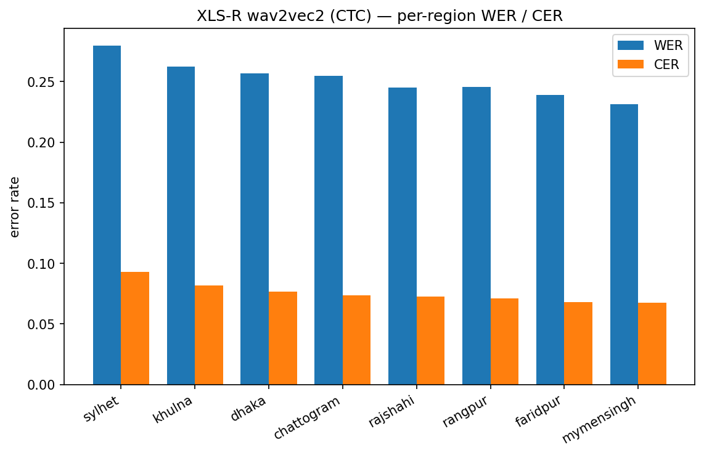

# STT — XLS-R wav2vec2 (CTC)

**Model:** `shahruk10/wav2vec2-xls-r-300m-bengali-commonvoice` (wav2vec2_ctc).

**Preprocessing:** 16 kHz mono; identical NFC + punctuation normalization on reference and hypothesis; no per-region denoising. Empty-audio utterances excluded from scoring (3 dropped).

## Overall

- WER **0.2542**, CER **0.077** over 12747 scored utterances (of 12750 transcribed; 3 excluded as empty audio).
## Per-region (sorted by CER, hardest first)

| region     |    WER |    CER |    n |
|:-----------|-------:|-------:|-----:|
| sylhet     | 0.2799 | 0.0931 | 2500 |
| khulna     | 0.2622 | 0.0817 | 1500 |
| dhaka      | 0.2566 | 0.0766 | 1500 |
| chattogram | 0.2545 | 0.0736 | 1500 |
| rajshahi   | 0.2452 | 0.0725 | 1500 |
| rangpur    | 0.2454 | 0.0711 | 1250 |
| faridpur   | 0.2389 | 0.0681 | 1749 |
| mymensingh | 0.2314 | 0.0675 | 1248 |

*XLS-R wav2vec2 (CTC) per-region WER/CER.*

## Notes

- Higher per-region error = farther from standard Bengali.
- Run the other model and `create_report.py` for the cross-model comparison and the region ranking averaged across models.