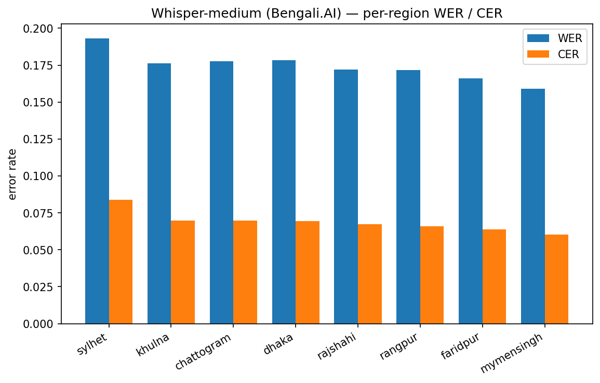

# STT — Whisper-medium (Bengali.AI)

**Model:** `bengaliAI/tugstugi_bengaliai-asr_whisper-medium` (whisper).

**Preprocessing:** 16 kHz mono; identical NFC + punctuation normalization on reference and hypothesis; no per-region denoising. Empty-audio utterances excluded from scoring (3 dropped).

## Overall

- WER **0.176**, CER **0.0701** over 12747 scored utterances (of 12750 transcribed; 3 excluded as empty audio).
## Per-region (sorted by CER, hardest first)

| region     |    WER |    CER |    n |
|:-----------|-------:|-------:|-----:|
| sylhet     | 0.1933 | 0.084  | 2500 |
| khulna     | 0.1764 | 0.0699 | 1500 |
| chattogram | 0.1776 | 0.0696 | 1500 |
| dhaka      | 0.1782 | 0.0695 | 1500 |
| rajshahi   | 0.1722 | 0.0673 | 1500 |
| rangpur    | 0.1718 | 0.0659 | 1250 |
| faridpur   | 0.1661 | 0.0638 | 1749 |
| mymensingh | 0.159  | 0.0604 | 1248 |

*Whisper-medium (Bengali.AI) per-region WER/CER.*

## Notes

- Higher per-region error = farther from standard Bengali.
- Run the other model and `create_report.py` for the cross-model comparison and the region ranking averaged across models.