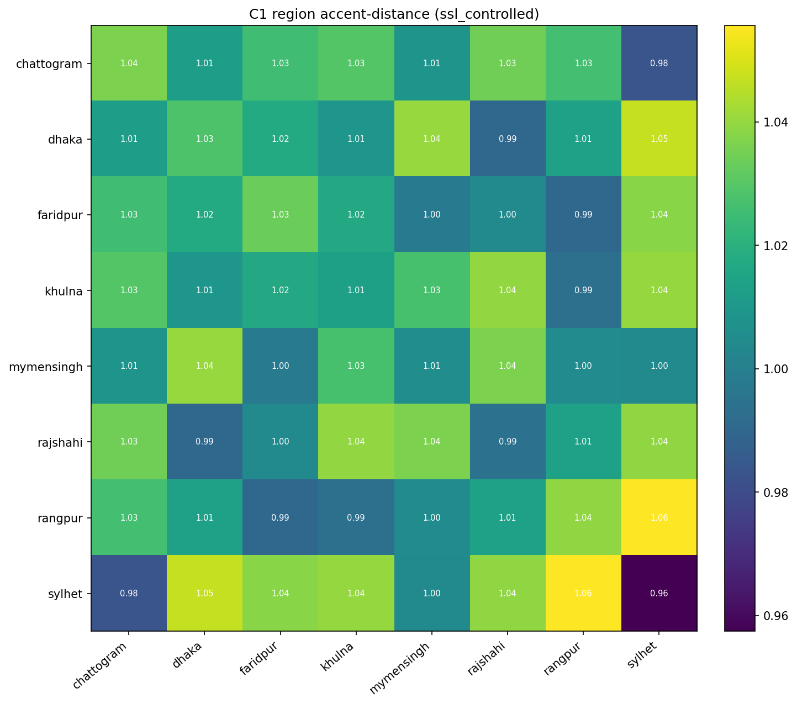
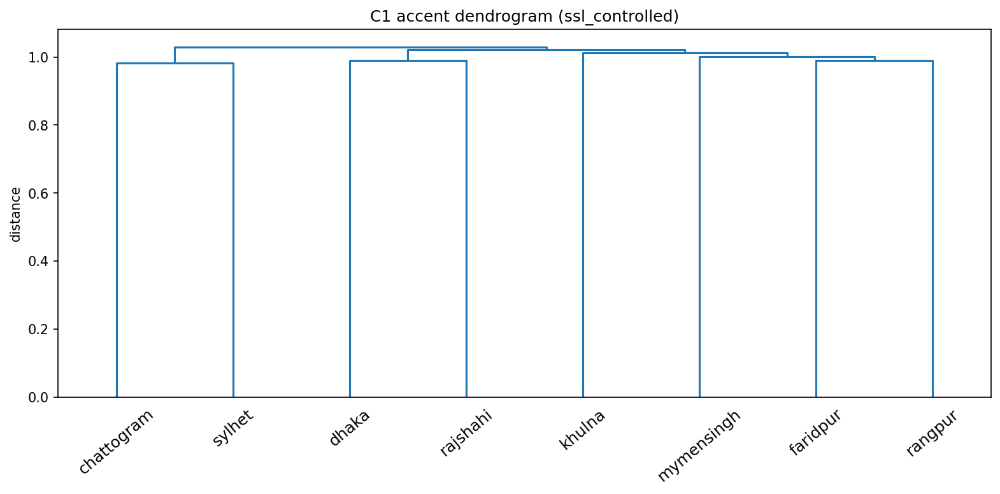

# C1 (v2) — Region Accent-Distance Matrix

**Features:** microsoft/wavlm-large (layer=middle) pooled (mean), cosine, per-sentence-centered.

**Corpus:** clean tree at `<PROJECT_ROOT>\data_clean` (uniform 16 kHz mono).

## Headline

- Closest: **chattogram ↔ sylhet** (0.9832).
- Farthest: **rangpur ↔ sylhet** (1.0556).
## Distance matrix

|            |   chattogram |   dhaka |   faridpur |   khulna |   mymensingh |   rajshahi |   rangpur |   sylhet |
|:-----------|-------------:|--------:|-----------:|---------:|-------------:|-----------:|----------:|---------:|
| chattogram |        1.036 |   1.012 |      1.025 |    1.029 |        1.008 |      1.034 |     1.026 |    0.983 |
| dhaka      |        1.012 |   1.028 |      1.017 |    1.009 |        1.04  |      0.99  |     1.013 |    1.047 |
| faridpur   |        1.025 |   1.017 |      1.033 |    1.017 |        0.998 |      1.004 |     0.991 |    1.038 |
| khulna     |        1.029 |   1.009 |      1.017 |    1.013 |        1.027 |      1.04  |     0.994 |    1.04  |
| mymensingh |        1.008 |   1.04  |      0.998 |    1.027 |        1.005 |      1.036 |     1.005 |    1.004 |
| rajshahi   |        1.034 |   0.99  |      1.004 |    1.04  |        1.036 |      0.994 |     1.014 |    1.039 |
| rangpur    |        1.026 |   1.013 |      0.991 |    0.994 |        1.005 |      1.014 |     1.039 |    1.056 |
| sylhet     |        0.983 |   1.047 |      1.038 |    1.04  |        1.004 |      1.039 |     1.056 |    0.957 |

## Distance from standard (dhaka)

| region     |   distance_from_standard |
|:-----------|-------------------------:|
| sylhet     |                   1.0471 |
| mymensingh |                   1.0404 |
| faridpur   |                   1.0174 |
| rangpur    |                   1.0134 |
| chattogram |                   1.0119 |
| khulna     |                   1.009  |
| rajshahi   |                   0.9904 |

*Region x region accent distance.*

*Hierarchical clustering of accents.*

## Note

- Now that audio format is uniform, a surviving cluster is dialectal rather than a recording-pipeline artifact.