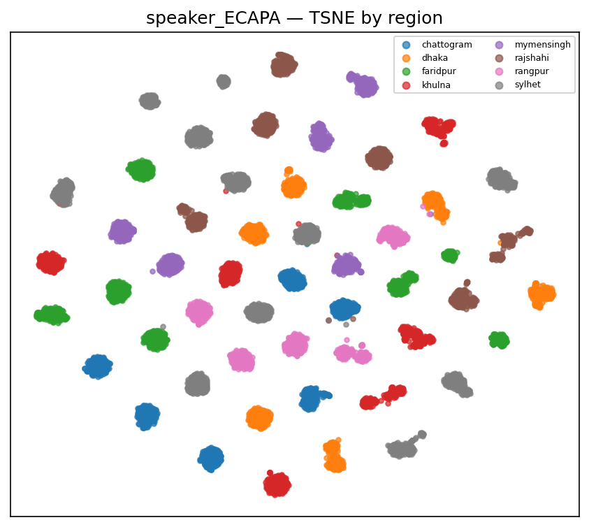
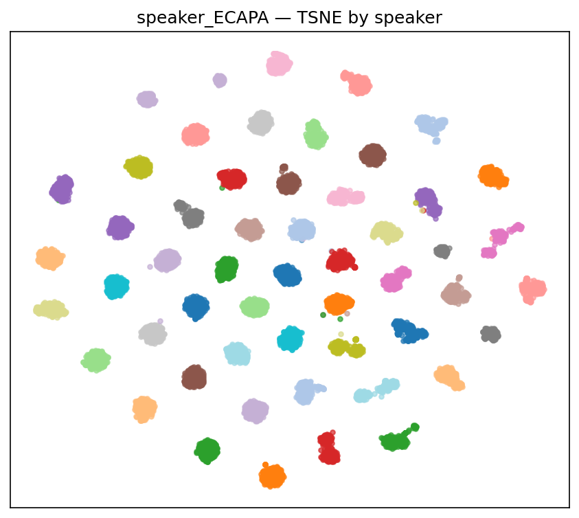
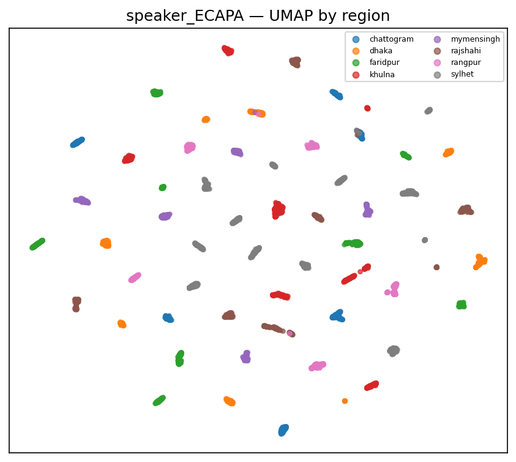
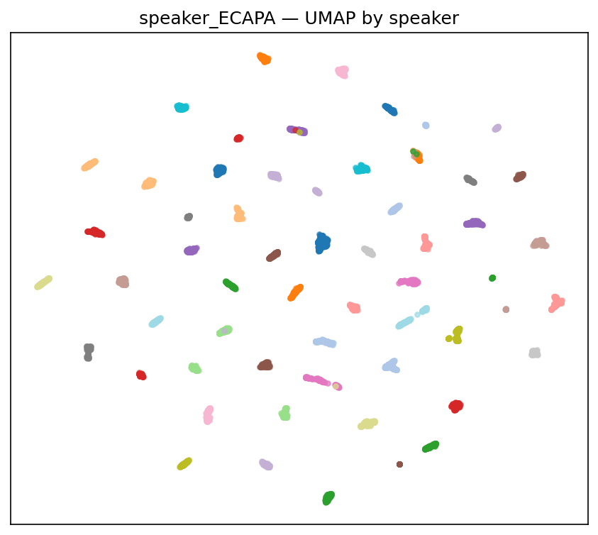
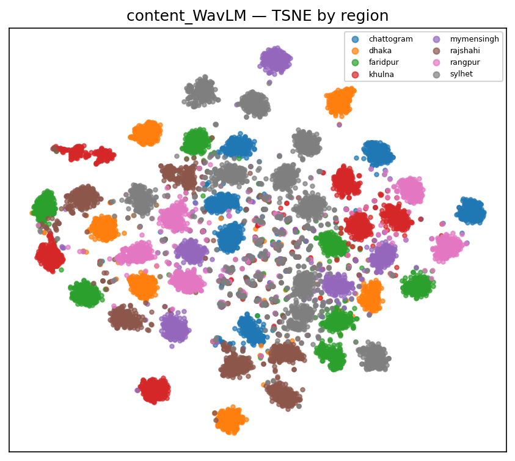
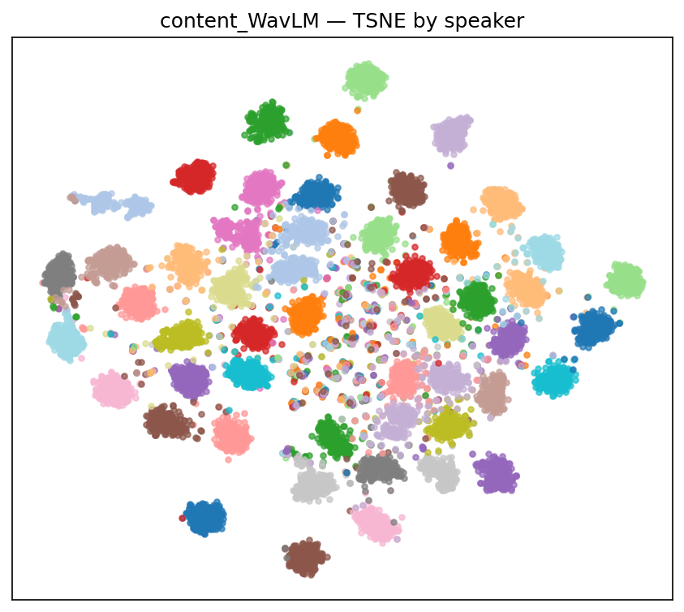
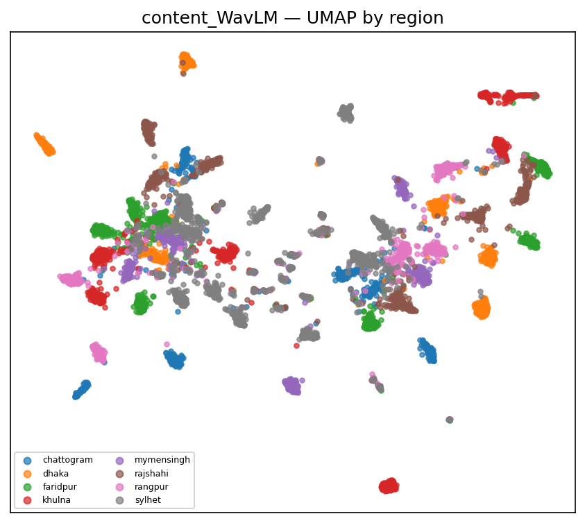
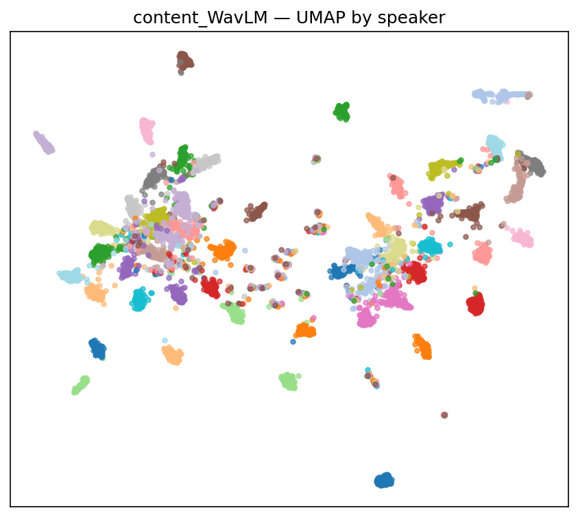

# C2 (v2) — Speaker-vs-Accent Separability

**Speaker:** `speechbrain/spkrec-ecapa-voxceleb` (ECAPA). **Content:** `microsoft/wavlm-large` (WavLM, layer=middle). **Corpus:** clean `C:\Users\redwa\OneDrive\Desktop\Thesis EDA\Thesis-BPAC-Exploratory-Data-analysis-of-the-novel-dataset\data_clean`.

## Leave-one-speaker-out region classification (the confound test)

- Accuracy on **unseen speakers**: **0.251** vs chance **0.125** (×2.0), macro-F1 0.195. High ⇒ accent generalizes across speakers and is not speaker memorization.
- Per-region recall (unseen speakers): {'chattogram': 0.026, 'dhaka': 0.052, 'faridpur': 0.275, 'khulna': 0.287, 'mymensingh': 0.087, 'rajshahi': 0.223, 'rangpur': 0.033, 'sylhet': 0.675}.
## Verdict

Region is predictable on UNSEEN speakers (LOSO accuracy 0.251 vs chance 0.125, ×2.0). Accent generalizes across speakers ⇒ the accent signal is GENUINE, not speaker identity.

## Silhouette scores

`*_residualized` removes each speaker's centroid. **Caveat:** because every speaker belongs to one region (speakers are *nested* in regions), removing the speaker mean also removes the region mean — so a near-zero residualized region score is **expected by design and does not mean accent is absent**. It quantifies how completely speaker and accent are confounded in this corpus. The LOSO test above is the valid measure of accent, because predicting region for an *unseen* speaker requires a speaker-independent accent signal.

| embedding_space                    |   silhouette_by_region |   silhouette_by_speaker |     n |
|:-----------------------------------|-----------------------:|------------------------:|------:|
| speaker_ECAPA                      |                 0.0338 |                  0.2976 | 12747 |
| content_WavLM                      |                -0.0021 |                  0.0791 | 12747 |
| content_WavLM_speaker_residualized |                -0.0178 |                 -0.0373 | 12747 |

- Per-sentence region silhouette (controls content; still carries the speaker confound): **-0.0609** over 250 sentences.
## Confusion (LOSO, row-normalized P(pred|true))

|            |   chattogram |   dhaka |   faridpur |   khulna |   mymensingh |   rajshahi |   rangpur |   sylhet |
|:-----------|-------------:|--------:|-----------:|---------:|-------------:|-----------:|----------:|---------:|
| chattogram |        0.026 |   0.174 |      0.087 |    0.039 |        0.029 |      0.172 |     0.142 |    0.331 |
| dhaka      |        0.225 |   0.052 |      0.067 |    0.043 |        0.067 |      0.397 |     0.023 |    0.127 |
| faridpur   |        0.031 |   0.021 |      0.275 |    0.063 |        0.083 |      0.2   |     0.078 |    0.249 |
| khulna     |        0.003 |   0.065 |      0.132 |    0.287 |        0.013 |      0.047 |     0.367 |    0.086 |
| mymensingh |        0.056 |   0.038 |      0.136 |    0.003 |        0.087 |      0.208 |     0.175 |    0.296 |
| rajshahi   |        0.119 |   0.155 |      0.211 |    0.019 |        0.095 |      0.223 |     0.031 |    0.145 |
| rangpur    |        0.02  |   0.047 |      0.145 |    0.399 |        0.114 |      0.082 |     0.033 |    0.159 |
| sylhet     |        0.1   |   0.017 |      0.07  |    0.002 |        0.008 |      0.058 |     0.069 |    0.675 |

## Projections

Coloured by region and by speaker, for content and speaker-residualized spaces.

### speaker_ECAPA — TSNE

*speaker_ECAPA TSNE by region.*

*speaker_ECAPA TSNE by speaker.*

### speaker_ECAPA — UMAP

*speaker_ECAPA UMAP by region.*

*speaker_ECAPA UMAP by speaker.*

### content_WavLM — TSNE

*content_WavLM TSNE by region.*

*content_WavLM TSNE by speaker.*

### content_WavLM — UMAP

*content_WavLM UMAP by region.*

*content_WavLM UMAP by speaker.*
