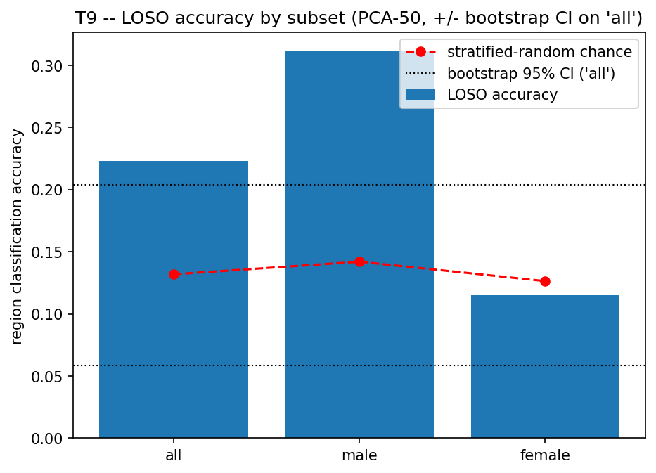
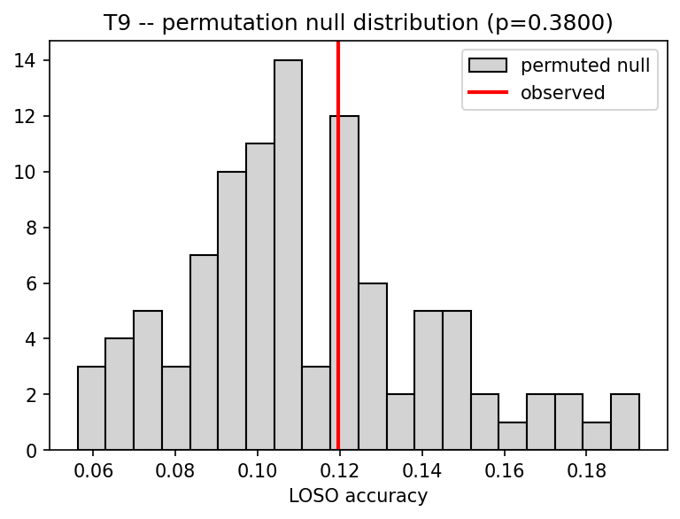

# T9 -- Within-Gender / Within-Pipeline LOSO

Because `pipeline` is perfectly confounded with `gender` (lab=male, app=female), the pooled LOSO result could in principle be detecting recording channel rather than accent. This reruns LOSO region classification separately within each gender, holding channel constant, plus a speaker-level permutation test, bootstrap CI, and an ECAPA (speaker-embedding) control.

## Headline: LOSO accuracy by subset

| subset   |   n_utterances |   n_speakers |   n_regions |   accuracy |   macro_f1 |   chance_uniform |   chance_majority_class |   chance_stratified_random |   lift_vs_stratified |
|:---------|---------------:|-------------:|------------:|-----------:|-----------:|-----------------:|------------------------:|---------------------------:|---------------------:|
| all      |          12747 |           51 |           8 |     0.2233 |     0.1964 |            0.125 |                  0.1961 |                     0.1319 |               1.6935 |
| male     |           6500 |           26 |           8 |     0.3111 |     0.217  |            0.125 |                  0.2308 |                     0.142  |               2.1905 |
| female   |           6247 |           25 |           8 |     0.1153 |     0.1195 |            0.125 |                  0.1601 |                     0.1264 |               0.9118 |

## Interpretation

Asymmetric result: within male/lab speakers accuracy is STRONG (0.311 vs chance 0.142) -- region is genuinely predictable on unseen lab-recorded speakers, so the accent signal in that half of the corpus is real, not channel. Within female/app speakers accuracy is AT OR BELOW chance (0.115 vs 0.126) -- either the app-recording channel carries less separable accent signal (compression, mic variability), or region is simply harder to detect from these speakers/regions with current methods. Do not report the pooled number as if it applies uniformly to the whole corpus -- report both halves and flag the female/app gap as an open question, not a null result to hide.

## Permutation test (pooled, speaker-level label shuffle)

Observed accuracy **0.1196** vs. permuted-null mean 0.1118 (sd 0.0300) over 100 permutations -> **p=0.3800**. (Reduced from the spec's suggested 1000 permutations for compute tractability -- LDA refit is the bottleneck; see module docstring.)

## Bootstrap 95% CI (resampling speakers)

[0.0585, 0.2040] over 100 valid resamples.

## ECAPA (speaker-embedding) control

If the speaker embedding (trained for speaker verification, not content) predicts region about as well as the content embedding, the signal is speaker identity, not accent. ECAPA accuracy **0.1689** (lift 1.28x) vs. content accuracy **0.2233**.

## Silhouette by subset

| subset   |   silhouette_by_region |   silhouette_by_speaker |
|:---------|-----------------------:|------------------------:|
| all      |                -0.0021 |                  0.0791 |
| male     |                 0.0191 |                  0.0814 |
| female   |                 0.0142 |                  0.0788 |

## Figures

*LOSO accuracy by subset vs. stratified-random chance.*

*Permutation null distribution vs. observed accuracy.*

## For the paper

S6.3-S6.4: this is the single most important defensive result in the paper. Lead with the within-gender result, not the pooled one, and report the permutation p-value alongside the accuracy so the claim is statistically defensible, not just 'twice chance'.
