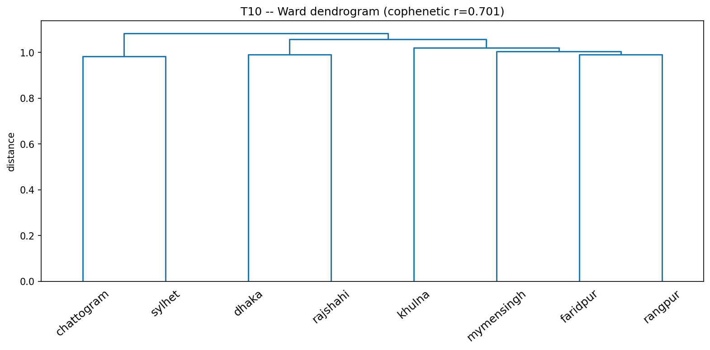
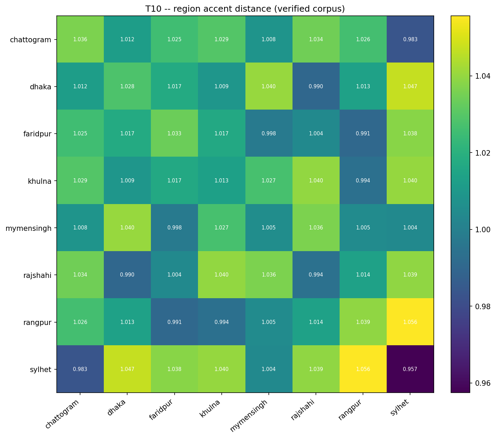

# T10 -- Region Accent-Distance Matrix: Statistics

C1's `ssl_controlled` distance matrix already reflects the T5-verified corpus (data_clean/ did not change during re-freeze). This adds bootstrap CIs, a Mantel test against geographic distance, and Ward clustering + cophenetic correlation, to say whether the near-1.0 pairwise distances in C1 (e.g. closest 0.983, farthest 1.056) are a reliable ordering or noise.

## Is the closest/farthest ordering reliable?

Closest pair **chattogram-sylhet** = 0.9832 (95% CI [0.9622, 1.0202]); farthest pair **rangpur-sylhet** = 1.0556 (95% CI [1.0236, 1.1255]). CIs do not overlap -- the ordering is statistically reliable.

## Mantel test: does acoustic distance track geography?

- Pearson r=0.175, p=0.3333 (10000 permutations)
- Spearman r=0.149, p=0.4206
A significant positive correlation would mean acoustic distance tracks geography (a clean, interpretable result); a null result is also reportable and expected given how weak the unsupervised distances are overall (see S6.2's honest-negative-result framing).

## Ward clustering

- Cophenetic correlation = **0.7006** (how well the dendrogram represents the full distance matrix; closer to 1 = more faithful).

*Ward dendrogram of region accent distances.*

*Region x region accent distance heatmap.*

## Bootstrap CIs, all pairs

| region_a   | region_b   |   observed |   boot_mean |   ci_low |   ci_high |   n_boot_valid |
|:-----------|:-----------|-----------:|------------:|---------:|----------:|---------------:|
| chattogram | sylhet     |     0.9832 |      0.9921 |   0.9622 |    1.0202 |            200 |
| dhaka      | rajshahi   |     0.9904 |      1.0023 |   0.9491 |    1.0564 |            200 |
| faridpur   | rangpur    |     0.9906 |      1.004  |   0.9741 |    1.0385 |            200 |
| khulna     | rangpur    |     0.9937 |      1.005  |   0.9607 |    1.0552 |            200 |
| faridpur   | mymensingh |     0.9981 |      1.0095 |   0.9686 |    1.0587 |            200 |
| faridpur   | rajshahi   |     1.0039 |      1.0137 |   0.9703 |    1.0596 |            200 |
| mymensingh | sylhet     |     1.0042 |      1.0134 |   0.9627 |    1.0567 |            200 |
| mymensingh | rangpur    |     1.0047 |      1.012  |   0.9526 |    1.0686 |            200 |
| chattogram | mymensingh |     1.0083 |      1.0214 |   0.9759 |    1.0722 |            200 |
| dhaka      | khulna     |     1.009  |      1.0179 |   0.9806 |    1.0512 |            200 |
| chattogram | dhaka      |     1.0119 |      1.0217 |   0.9802 |    1.0668 |            200 |
| dhaka      | rangpur    |     1.0134 |      1.0261 |   0.9596 |    1.0837 |            200 |
| rajshahi   | rangpur    |     1.0138 |      1.0265 |   0.963  |    1.0933 |            200 |
| faridpur   | khulna     |     1.0168 |      1.0269 |   0.9823 |    1.0739 |            200 |
| dhaka      | faridpur   |     1.0174 |      1.0293 |   0.9959 |    1.0934 |            200 |
| chattogram | faridpur   |     1.0254 |      1.0354 |   0.9987 |    1.0768 |            200 |
| chattogram | rangpur    |     1.0264 |      1.0357 |   0.9926 |    1.0805 |            200 |
| khulna     | mymensingh |     1.0272 |      1.0362 |   0.9925 |    1.0793 |            200 |
| chattogram | khulna     |     1.0295 |      1.0434 |   1.0133 |    1.0811 |            200 |
| chattogram | rajshahi   |     1.0343 |      1.046  |   0.9885 |    1.0966 |            200 |
| mymensingh | rajshahi   |     1.0361 |      1.0458 |   1.0083 |    1.0803 |            200 |
| faridpur   | sylhet     |     1.0383 |      1.0477 |   1.0062 |    1.083  |            200 |
| rajshahi   | sylhet     |     1.0394 |      1.0505 |   1.009  |    1.0942 |            200 |
| khulna     | rajshahi   |     1.0398 |      1.0486 |   1.0035 |    1.0973 |            200 |
| khulna     | sylhet     |     1.0403 |      1.0506 |   1.021  |    1.0853 |            200 |
| dhaka      | mymensingh |     1.0404 |      1.0521 |   1.0022 |    1.1051 |            200 |
| dhaka      | sylhet     |     1.0471 |      1.0569 |   1.0253 |    1.0963 |            200 |
| rangpur    | sylhet     |     1.0556 |      1.0643 |   1.0236 |    1.1255 |            200 |

## For the paper

S6.2 and the left panel of T19's headline figure. If CIs overlap, state plainly that the unsupervised distance matrix does not reliably order regions -- this motivates T9's discriminative LOSO test and Part D's phonetic distance matrix (T18) as the more decisive analyses.
