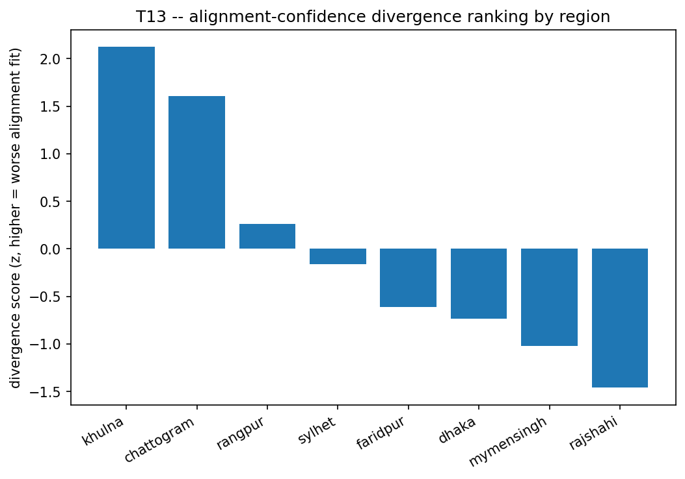
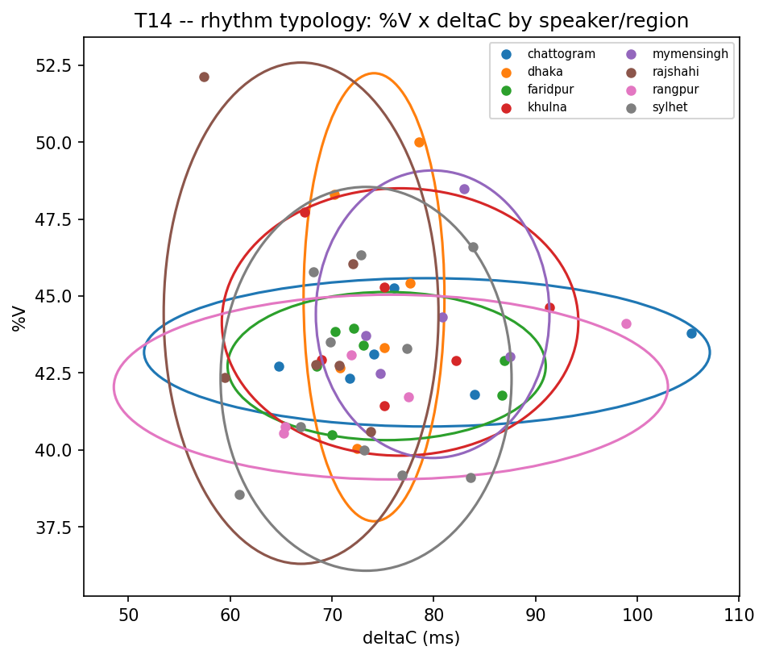

# T13-T14 -- Alignment Confidence, Phone Duration & Rhythm

## T13 -- alignment confidence as a divergence signal

The lexicon encodes standard Bangla; where a region diverges most, the aligner fits worst (more implausibly short phones, more overlong non-vowels). This ranks regions by that divergence, free from the aligner's own diagnostics.

| region     |   n_utterances |   mean_pct_short |   mean_pct_long_nonvowel |   divergence_score |
|:-----------|---------------:|-----------------:|-------------------------:|-------------------:|
| khulna     |           1489 |            4.593 |                    0.101 |              2.123 |
| chattogram |           1495 |            3.982 |                    0.177 |              1.604 |
| rangpur    |           1243 |            4.083 |                    0.114 |              0.259 |
| sylhet     |           2442 |            4.233 |                    0.076 |             -0.158 |
| faridpur   |           1740 |            3.977 |                    0.1   |             -0.614 |
| dhaka      |           1491 |            3.935 |                    0.102 |             -0.731 |
| mymensingh |           1246 |            3.889 |                    0.099 |             -1.023 |
| rajshahi   |           1489 |            4.075 |                    0.054 |             -1.459 |

- Correlation with per-region WER: {'divergence_vs_WER': {'rho': 0.30952380952380953, 'p': 0.4556448907375822}}

*Alignment-divergence ranking by region.*

## T14 -- phone duration & rhythm

Mixed-effects models (`dur_z ~ region + (1|speaker)`) fit for 39 phones with >= 200 tokens; FDR-corrected across phones. Rhythm metrics computed for 12635 utterances.

| region     |   pctV |   deltaV |   deltaC |   VarcoV |   VarcoC |   nPVI_V |   rPVI_C |
|:-----------|-------:|---------:|---------:|---------:|---------:|---------:|---------:|
| chattogram | 43.169 |   51.011 |   79.324 |   57.114 |   68.334 |   52.723 |   85.434 |
| dhaka      | 44.964 |   50.151 |   74.115 |   56.553 |   69.335 |   53.576 |   79.508 |
| faridpur   | 42.722 |   49.052 |   75.353 |   58.392 |   68.264 |   53.176 |   81.678 |
| khulna     | 44.158 |   51.327 |   76.674 |   57.941 |   69.569 |   54.853 |   82.027 |
| mymensingh | 44.412 |   55.834 |   79.868 |   59.773 |   69.082 |   53.885 |   84.119 |
| rajshahi   | 44.451 |   46.218 |   66.945 |   57.584 |   67.691 |   53.515 |   71.784 |
| rangpur    | 42.048 |   48.608 |   75.828 |   58.151 |   67.217 |   53.622 |   82.243 |
| sylhet     | 42.248 |   46.8   |   73.146 |   58.904 |   68.717 |   53.195 |   79.286 |

*Rhythm typology: %V x deltaC by speaker, colored by region.*

## Phonetic shift table (most lengthened/shortened phones per region)

| region     | phone   |   shift_z | direction   |
|:-----------|:--------|----------:|:------------|
| chattogram | iN      |    -0.061 | shortened   |
| chattogram | l       |    -0.045 | shortened   |
| chattogram | ri      |    -0.043 | shortened   |
| chattogram | Th      |     0.063 | lengthened  |
| chattogram | h       |     0.128 | lengthened  |
| chattogram | Dh      |     0.151 | lengthened  |
| dhaka      | Dh      |    -0.221 | shortened   |
| dhaka      | ph      |    -0.191 | shortened   |
| dhaka      | ng      |    -0.118 | shortened   |
| dhaka      | oi      |     0.101 | lengthened  |
| dhaka      | uN      |     0.183 | lengthened  |
| dhaka      | ri      |     0.187 | lengthened  |
| faridpur   | ou      |    -0.14  | shortened   |
| faridpur   | j       |    -0.085 | shortened   |
| faridpur   | oi      |    -0.075 | shortened   |
| faridpur   | th      |     0.09  | lengthened  |
| faridpur   | ph      |     0.09  | lengthened  |
| faridpur   | p       |     0.095 | lengthened  |
| khulna     | Dh      |    -0.324 | shortened   |
| khulna     | p       |    -0.14  | shortened   |
| khulna     | ph      |    -0.133 | shortened   |
| khulna     | Th      |     0.053 | lengthened  |
| khulna     | a       |     0.054 | lengthened  |
| khulna     | y       |     0.057 | lengthened  |
| mymensingh | c       |    -0.179 | shortened   |
| mymensingh | dh      |    -0.173 | shortened   |
| mymensingh | s       |    -0.167 | shortened   |
| mymensingh | iN      |     0.087 | lengthened  |
| mymensingh | e       |     0.104 | lengthened  |
| mymensingh | j       |     0.148 | lengthened  |
| rajshahi   | kh      |    -0.154 | shortened   |
| rajshahi   | s       |    -0.124 | shortened   |
| rajshahi   | h       |    -0.119 | shortened   |
| rajshahi   | o       |     0.084 | lengthened  |
| rajshahi   | uN      |     0.09  | lengthened  |
| rajshahi   | aN      |     0.261 | lengthened  |
| rangpur    | ph      |    -0.144 | shortened   |
| rangpur    | aN      |    -0.135 | shortened   |
| rangpur    | e       |    -0.119 | shortened   |
| rangpur    | ch      |     0.16  | lengthened  |
| rangpur    | th      |     0.189 | lengthened  |
| rangpur    | Dh      |     0.259 | lengthened  |
| sylhet     | aN      |    -0.153 | shortened   |
| sylhet     | uN      |    -0.14  | shortened   |
| sylhet     | y       |    -0.085 | shortened   |
| sylhet     | c       |     0.148 | lengthened  |
| sylhet     | gh      |     0.158 | lengthened  |
| sylhet     | ph      |     0.224 | lengthened  |

## For the paper

S7.2-S7.3. `phonetic_shift_table.csv` is a main paper table.
