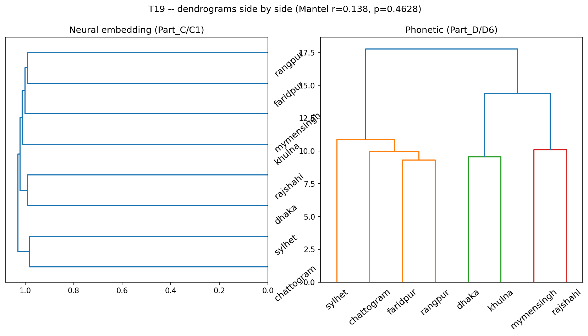
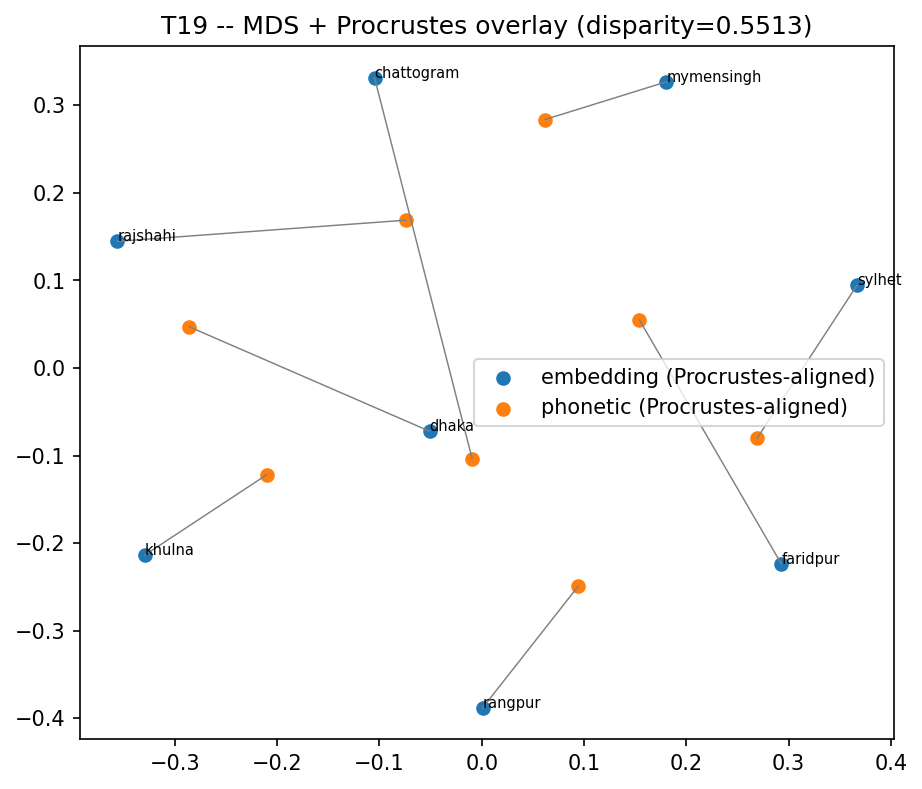

# T19 -- Convergence Test: Phonetic vs. Neural-Embedding Distance

Two independently-derived 8x8 region distance matrices -- one from opaque self-supervised embeddings (Part_C/C1), one from hand-measured phonetics (Part_D/D6) -- compared directly. This is the headline statistic of the paper.

## Mantel test

- Pearson r=0.138, p=0.4628 (10000 permutations)
- Spearman r=0.226, p=0.2327
## Procrustes

- Disparity (MDS 2D alignment residual): **0.5513** (lower = better geometric agreement)
## Per-region agreement

| region     |   row_correlation |
|:-----------|------------------:|
| chattogram |             0.964 |
| rajshahi   |             0.955 |
| mymensingh |             0.946 |
| khulna     |             0.937 |
| dhaka      |             0.932 |
| sylhet     |             0.927 |
| faridpur   |             0.917 |
| rangpur    |             0.898 |

## Three-way check against geography (T10)

- geography vs. embedding: r=0.175, p=0.3293
- geography vs. phonetic: r=-0.197, p=0.3762
## Figures

*Neural vs. phonetic dendrograms side by side.*

*MDS + Procrustes overlay -- MAIN PAPER FIGURE.*

## For the paper

S7.8 and the abstract. This is the headline figure.
