# Part D — Combined Reports (D0–D7)

Consolidated from each experiment's own `D*/reports/report.md`. Figure paths
below have been rewritten relative to this file's location
(`Part_D/reports.md`); all other text is reproduced verbatim from the
individual reports.

---

## D0 — T11: Bangla Pronunciation Lexicon

**2011 unique word types** (3384 tokens) extracted from the 250-sentence script and converted with a rule-based G2P (100% coverage by construction -- see `D0_lexicon/reports/phoneset.md` for the phone set and every documented simplification). **1093 words are flagged `medial_schwa_deletion_risk`** -- the known weak point of the schwa-deletion rule -- and should get extra scrutiny in review.

### Cross-check attempts (per spec: don't rely on a single library)

- `epitran` (ben-Beng): installed, but its `panphon` dependency uses Python 3.10+ syntax and fails to import under this repo's Python 3.9. Not usable here.
- `bnlp_toolkit`: installed, has tokenization/NER/POS/embeddings but no G2P/phoneme module at all.
- Rule-based `bpac_phon/g2p.py` is therefore **authoritative**, as the spec allows for exactly this situation.

### MANUAL REVIEW -- COMPLETE (2026-07-25)

`lexicon_review.csv` contains the top 500 words by frequency + a random 200-word tail sample (700 rows total, covering the large majority of corpus tokens by frequency-weighting). All 700 rows were manually reviewed by the corpus author, checking `auto_g2p` against `word` (with particular attention to the `medial_schwa_deletion_risk=True` rows -- the schwa-deletion rule's known weak point). **Verdict: accurate overall.** No specific per-word corrections were flagged as necessary; `corrected_g2p` is left blank throughout, meaning `auto_g2p` was accepted as-is for every reviewed row. See `review_notes` for the exact reviewer statement. This was a holistic pass, not a documented word-by-word correction log -- if a specific error surfaces later (e.g. during forced-alignment QA), fix it directly in `bpac_lexicon.txt` and note it here.

### Coverage

- `n_sentence_tokens` = 3384
- `n_unique_types` = 2011
- `n_types_with_pronunciation` = 2011
- `coverage_pct` = 100.0
- `n_numeral_tokens` = 51
- `numeral_note` = Digit-by-digit fallback reading (not natural numeral verbalization, e.g. '2023' read as 'two-zero-two-three' not 'two thousand twenty-three') -- flagged needs_numeral_verbalization_review=True for manual correction.
- `n_flagged_medial_schwa_risk` = 1093
- `n_flagged_conjunct` = 517
- `n_format_char_tokens_dropped` = 1
- `phone_set_size` = 45

### For the paper

S7.1 method + release artifact list (S9): a verified 2,012-word Bangla pronunciation dictionary is a citable contribution in its own right -- cite the coverage numbers above and state the manual-review sample size once review is complete.

---

## D1 — T12: Forced Alignment: Parsed TextGrids

Parsed **12635/12747** utterances' TextGrids into 959881 phone tokens and 170033 word tokens. 112 utterances have no TextGrid (alignment failed or were skipped).

### Sanity checks

- Phones under 10ms: 22342 (2.328%) -- the aligner squeezing a phone it couldn't confidently place.

### Per-region alignment stats

| region     |   n_phones |   n_utterances |   mean_dur_s |   pct_short |
|:-----------|-----------:|---------------:|-------------:|------------:|
| chattogram |     114190 |           1495 |       0.08   |      2.3636 |
| dhaka      |     113603 |           1491 |       0.0768 |      2.389  |
| faridpur   |     132447 |           1740 |       0.0761 |      2.3119 |
| khulna     |     113724 |           1489 |       0.0783 |      2.3539 |
| mymensingh |      95179 |           1246 |       0.0816 |      2.323  |
| rajshahi   |     113374 |           1489 |       0.0701 |      2.4027 |
| rangpur    |      94990 |           1243 |       0.0768 |      2.3497 |
| sylhet     |     182374 |           2442 |       0.0727 |      2.2059 |

---

## D2 — T13-T14: Alignment Confidence, Phone Duration & Rhythm

### T13 -- alignment confidence as a divergence signal

The lexicon encodes standard Bangla; where a region diverges most, the aligner fits worst (more implausibly short phones, more overlong non-vowels). This ranks regions by that divergence, free from the aligner's own diagnostics.

| region     |   n_utterances |   mean_pct_short |   mean_pct_long_nonvowel |   divergence_score |
|:-----------|---------------:|------------------:|--------------------------:|--------------------:|
| khulna     |           1489 |            4.593 |                    0.101 |              2.123 |
| chattogram |           1495 |            3.982 |                    0.177 |              1.604 |
| rangpur    |           1243 |            4.083 |                    0.114 |              0.259 |
| sylhet     |           2442 |            4.233 |                    0.076 |             -0.158 |
| faridpur   |           1740 |            3.977 |                    0.1   |             -0.614 |
| dhaka      |           1491 |            3.935 |                    0.102 |             -0.731 |
| mymensingh |           1246 |            3.889 |                    0.099 |             -1.023 |
| rajshahi   |           1489 |            4.075 |                    0.054 |             -1.459 |

- Correlation with per-region WER: {'divergence_vs_WER': {'rho': 0.30952380952380953, 'p': 0.4556448907375822}}

*Alignment-divergence ranking by region.*

### T14 -- phone duration & rhythm

Mixed-effects models (`dur_z ~ region + (1|speaker)`) fit for 39 phones with >= 200 tokens; FDR-corrected across phones. Rhythm metrics computed for 12635 utterances.

| region     |   pctV |   deltaV |   deltaC |   VarcoV |   VarcoC |   nPVI_V |   rPVI_C |
|:-----------|-------:|---------:|---------:|---------:|---------:|---------:|---------:|
| chattogram | 43.169 |   51.011 |   79.324 |   57.114 |   68.334 |   52.723 |   85.434 |
| dhaka      | 44.964 |   50.151 |   74.115 |   56.553 |   69.335 |   53.576 |   79.508 |
| faridpur   | 42.722 |   49.052 |   75.353 |   58.392 |   68.264 |   53.176 |   81.678 |
| khulna     | 44.158 |   51.327 |   76.674 |   57.941 |   69.569 |   54.853 |   82.027 |
| mymensingh | 44.412 |   55.834 |   79.868 |   59.773 |   69.082 |   53.885 |   84.119 |
| rajshahi   | 44.451 |   46.218 |   66.945 |   57.584 |   67.691 |   53.515 |   71.784 |
| rangpur    | 42.048 |   48.608 |   75.828 |   58.151 |   67.217 |   53.622 |   82.243 |
| sylhet     | 42.248 |   46.8   |   73.146 |   58.904 |   68.717 |   53.195 |   79.286 |

*Rhythm typology: %V x deltaC by speaker, colored by region.*

### Phonetic shift table (most lengthened/shortened phones per region)

| region     | phone   |   shift_z | direction   |
|:-----------|:--------|----------:|:------------|
| chattogram | iN      |    -0.061 | shortened   |
| chattogram | l       |    -0.045 | shortened   |
| chattogram | ri      |    -0.043 | shortened   |
| chattogram | Th      |     0.063 | lengthened  |
| chattogram | h       |     0.128 | lengthened  |
| chattogram | Dh      |     0.151 | lengthened  |
| dhaka      | Dh      |    -0.221 | shortened   |
| dhaka      | ph      |    -0.191 | shortened   |
| dhaka      | ng      |    -0.118 | shortened   |
| dhaka      | oi      |     0.101 | lengthened  |
| dhaka      | uN      |     0.183 | lengthened  |
| dhaka      | ri      |     0.187 | lengthened  |
| faridpur   | ou      |    -0.14  | shortened   |
| faridpur   | j       |    -0.085 | shortened   |
| faridpur   | oi      |    -0.075 | shortened   |
| faridpur   | th      |     0.09  | lengthened  |
| faridpur   | ph      |     0.09  | lengthened  |
| faridpur   | p       |     0.095 | lengthened  |
| khulna     | Dh      |    -0.324 | shortened   |
| khulna     | p       |    -0.14  | shortened   |
| khulna     | ph      |    -0.133 | shortened   |
| khulna     | Th      |     0.053 | lengthened  |
| khulna     | a       |     0.054 | lengthened  |
| khulna     | y       |     0.057 | lengthened  |
| mymensingh | c       |    -0.179 | shortened   |
| mymensingh | dh      |    -0.173 | shortened   |
| mymensingh | s       |    -0.167 | shortened   |
| mymensingh | iN      |     0.087 | lengthened  |
| mymensingh | e       |     0.104 | lengthened  |
| mymensingh | j       |     0.148 | lengthened  |
| rajshahi   | kh      |    -0.154 | shortened   |
| rajshahi   | s       |    -0.124 | shortened   |
| rajshahi   | h       |    -0.119 | shortened   |
| rajshahi   | o       |     0.084 | lengthened  |
| rajshahi   | uN      |     0.09  | lengthened  |
| rajshahi   | aN      |     0.261 | lengthened  |
| rangpur    | ph      |    -0.144 | shortened   |
| rangpur    | aN      |    -0.135 | shortened   |
| rangpur    | e       |    -0.119 | shortened   |
| rangpur    | ch      |     0.16  | lengthened  |
| rangpur    | th      |     0.189 | lengthened  |
| rangpur    | Dh      |     0.259 | lengthened  |
| sylhet     | aN      |    -0.153 | shortened   |
| sylhet     | uN      |    -0.14  | shortened   |
| sylhet     | y       |    -0.085 | shortened   |
| sylhet     | c       |     0.148 | lengthened  |
| sylhet     | gh      |     0.158 | lengthened  |
| sylhet     | ph      |     0.224 | lengthened  |

### For the paper

S7.2-S7.3. `phonetic_shift_table.csv` is a main paper table.

---

## D3 — T15: Vowel Space (Lobanov-Normalized F1/F2)

203425/205714 vowel tokens retained (98.89%) after duration/adjacency/formant-range filtering. Lobanov-normalized per speaker to remove vocal-tract-length differences while preserving dialect differences.

### Retention by region

| region     |   stage_candidate |   stage_retained |   retention_pct |
|:-----------|------------------:|------------------:|----------------:|
| chattogram |             25397 |            25029 |           98.55 |
| dhaka      |             25524 |            25342 |           99.29 |
| faridpur   |             28351 |            28125 |           99.2  |
| khulna     |             25188 |            24845 |           98.64 |
| mymensingh |             21976 |            21800 |           99.2  |
| rajshahi   |             23278 |            22924 |           98.48 |
| rangpur    |             19808 |            19590 |           98.9  |
| sylhet     |             36192 |            35770 |           98.83 |

### Vowel space area by region

| region     |   vowel_space_area |   n_vowel_types |
|:-----------|--------------------:|----------------:|
| sylhet     |              2.636 |               8 |
| mymensingh |              2.616 |               8 |
| faridpur   |              2.388 |               8 |
| rajshahi   |              2.321 |               8 |
| rangpur    |              2.246 |               8 |
| chattogram |              2.083 |               8 |
| dhaka      |              1.943 |               8 |
| khulna     |              1.924 |               8 |

### Pillai scores (near-vowel-pair distinctness; near 0 = merged)

| region     | pair   |   pillai |
|:-----------|:-------|---------:|
| chattogram | e-i    |   0.3246 |
| chattogram | o-u    |   0.1836 |
| chattogram | O-o    |   0.0395 |
| chattogram | a-O    |   0.3013 |
| dhaka      | e-i    |   0.2987 |
| dhaka      | o-u    |   0.2015 |
| dhaka      | O-o    |   0.0284 |
| dhaka      | a-O    |   0.2974 |
| faridpur   | e-i    |   0.2255 |
| faridpur   | o-u    |   0.1924 |
| faridpur   | O-o    |   0.0707 |
| faridpur   | a-O    |   0.4543 |
| khulna     | e-i    |   0.2444 |
| khulna     | o-u    |   0.1988 |
| khulna     | O-o    |   0.0258 |
| khulna     | a-O    |   0.2954 |
| mymensingh | e-i    |   0.2988 |
| mymensingh | o-u    |   0.1896 |
| mymensingh | O-o    |   0.0631 |
| mymensingh | a-O    |   0.5327 |
| rajshahi   | e-i    |   0.2356 |
| rajshahi   | o-u    |   0.1665 |
| rajshahi   | O-o    |   0.0635 |
| rajshahi   | a-O    |   0.4437 |
| rangpur    | e-i    |   0.2594 |
| rangpur    | o-u    |   0.2152 |
| rangpur    | O-o    |   0.0407 |
| rangpur    | a-O    |   0.3913 |
| sylhet     | e-i    |   0.403  |
| sylhet     | o-u    |   0.2096 |
| sylhet     | O-o    |   0.0469 |
| sylhet     | a-O    |   0.4518 |

### Figures

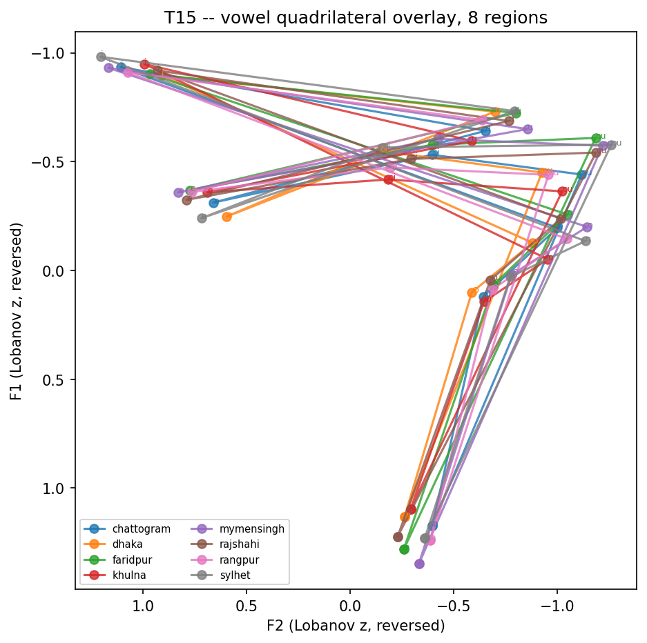

*8-region vowel quadrilateral overlay -- main paper figure.*

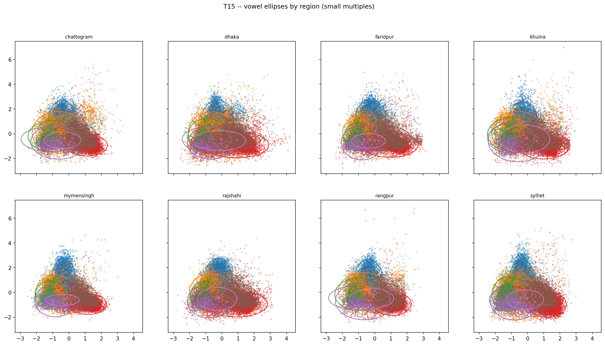

*Vowel ellipses, small multiples by region.*

### For the paper

S7.4. The overlaid quadrilateral is a main paper figure.

---

## D4 — T16: Consonants: Sibilant Spectral Moments + VOT

**Sample-rate exception**: sibilant and VOT tokens are read from RAW audio resampled to 32 kHz, not data_clean/ (16 kHz) -- see module docstring / invariant 2.

### Sibilant CoG by region

| region     |    n |   cog_mean_hz |   cog_median_hz |   cog_z_mean |   cog_z_sem |
|:-----------|-----:|--------------:|-----------------:|-------------:|------------:|
| chattogram | 6155 |       5000.63 |          5167.82 |            0 |        0.01 |
| dhaka      | 6121 |       5418.8  |          5472.08 |            0 |        0.01 |
| faridpur   | 7050 |       5555.66 |          5508.89 |            0 |        0.01 |
| khulna     | 6025 |       5635.3  |          5711.48 |           -0 |        0.01 |
| mymensingh | 5139 |       5812.01 |          5763.34 |           -0 |        0.01 |
| rajshahi   | 5787 |       5396.25 |          5410.73 |           -0 |        0.01 |
| rangpur    | 5112 |       5602.42 |          5660.33 |           -0 |        0.01 |
| sylhet     | 9670 |       5515.17 |          5461.25 |            0 |        0.01 |

- Sylhet CoG shift vs. corpus mean: **28.7 Hz** (0.029 SD units).

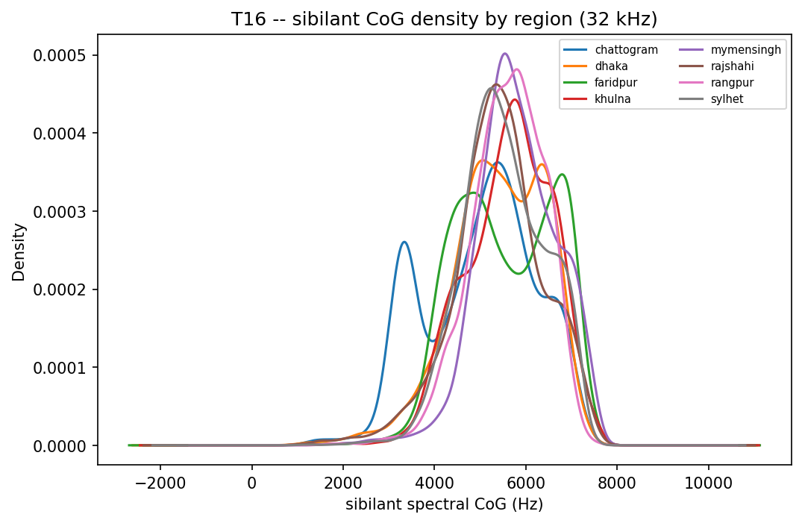

*Sibilant CoG density by region -- likely the most-quoted number in the paper.*

### VOT (word-initial four-way stops) -- PROVISIONAL, automatic only

74482/74590 candidates got an automatic VOT estimate. **Manual verification not yet done** -- `vot_manual_check_worklist.csv` (296 rows, ~37/region) needs a human to listen and correct `manual_vot_ms`. Report automatic-vs-manual agreement once reviewed; if poor, report VOT on the hand-checked subsample only.

| region     | phone   |    n |   mean_vot_ms |   sd_vot_ms |
|:-----------|:--------|-----:|---------------:|------------:|
| chattogram | D       |  137 |          4.32 |       16.08 |
| chattogram | Dh      |   36 |          2.5  |        5.48 |
| chattogram | T       |  209 |          7.56 |       20.93 |
| chattogram | Th      |   35 |         18.51 |       22.2  |
| chattogram | b       | 1880 |          2.48 |       10    |
| chattogram | bh      |  328 |          4.4  |       13.78 |
| chattogram | d       | 1077 |          2.53 |       10.16 |
| chattogram | dh      |  108 |          3.57 |       10.84 |
| chattogram | g       |  434 |          1.63 |        6.32 |
| chattogram | gh      |  126 |          2.05 |        7.55 |
| chattogram | k       | 1645 |          6.77 |       16.29 |
| chattogram | kh      |   89 |         15.39 |       22.6  |
| chattogram | p       | 1580 |          3.39 |       12.01 |
| chattogram | ph      |  204 |         26.79 |       45.17 |
| chattogram | t       |  764 |          3.23 |       11    |
| chattogram | th      |  207 |         14.86 |       25.88 |
| dhaka      | D       |  137 |          2.47 |        9.51 |
| dhaka      | Dh      |   35 |          2.57 |        7.78 |
| dhaka      | T       |  209 |          7.18 |       26.36 |
| dhaka      | Th      |   33 |         10.61 |       13.2  |
| dhaka      | b       | 1868 |          1.39 |        6.82 |
| dhaka      | bh      |  328 |          3.12 |        9.74 |
| dhaka      | d       | 1071 |          1.26 |        7.54 |
| dhaka      | dh      |  108 |          2    |        8.72 |
| dhaka      | g       |  430 |          1.21 |        4.73 |
| dhaka      | gh      |  126 |          4.16 |       11.07 |
| dhaka      | k       | 1632 |          5.76 |       16.9  |
| dhaka      | kh      |   89 |         11.55 |       21.15 |
| dhaka      | p       | 1574 |          3.26 |       10.01 |
| dhaka      | ph      |  201 |         16.89 |       30    |
| dhaka      | t       |  762 |          2.43 |       10.38 |
| dhaka      | th      |  208 |         13.04 |       25.08 |
| faridpur   | D       |  157 |          4.03 |       19.89 |
| faridpur   | Dh      |   42 |          3.81 |        8.26 |
| faridpur   | T       |  234 |          9.22 |       27.17 |
| faridpur   | Th      |   39 |         27.79 |       22.22 |
| faridpur   | b       | 2185 |          2.33 |        9.78 |
| faridpur   | bh      |  383 |          2.56 |        9.12 |
| faridpur   | d       | 1242 |          1.96 |        9.36 |
| faridpur   | dh      |  125 |          5.07 |       11.61 |

### For the paper

S7.5. The sibilant CoG result is likely the paper's most-quoted number.

---

## D5 — T17: Intonation: Averaged F0 Contours

12744/12747 utterances got a usable F0 contour. Averaging across speakers within region is only meaningful because every speaker reads the same sentences -- this figure is the visual argument for parallelism.

### Example contours (sentences with the most cross-region divergence)

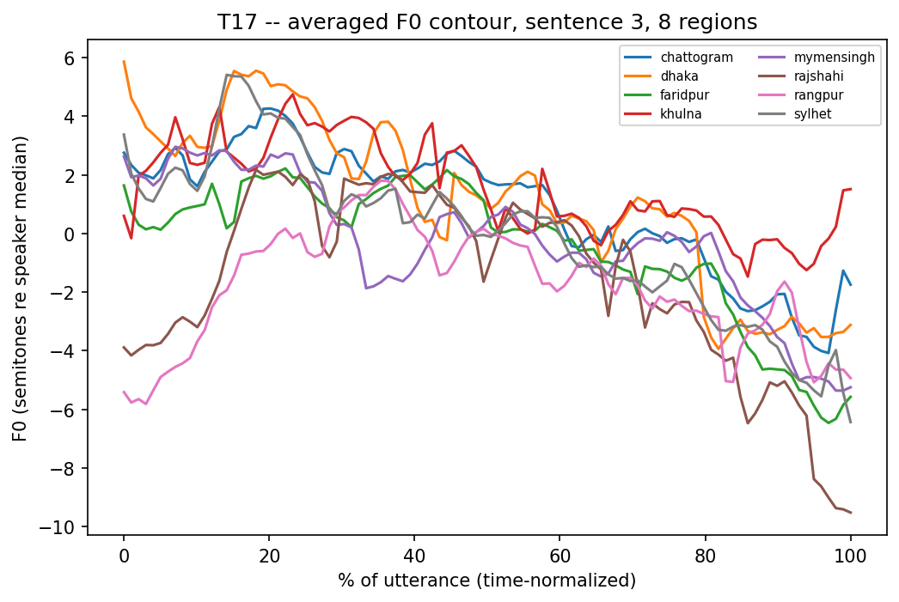

*f0_contour_8regions_sentence3.png*

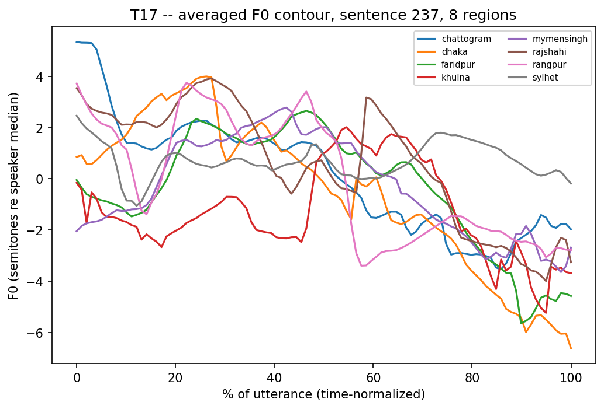

*f0_contour_8regions_sentence237.png*

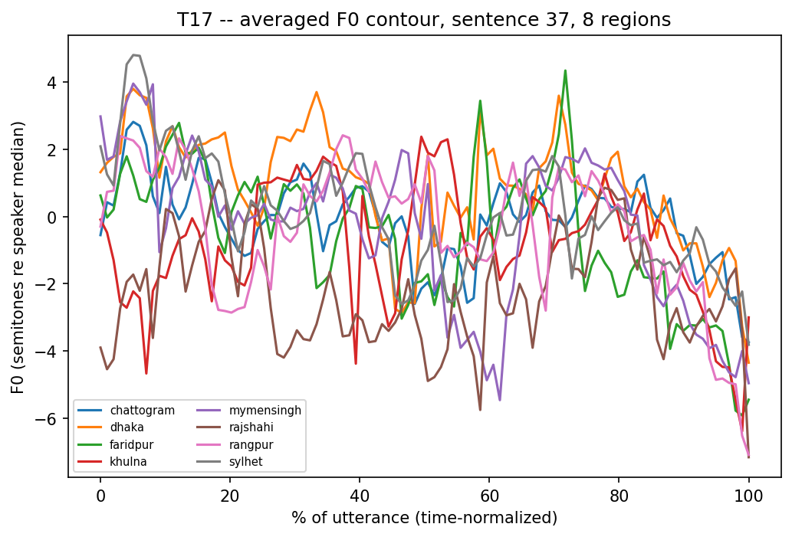

*f0_contour_8regions_sentence37.png*

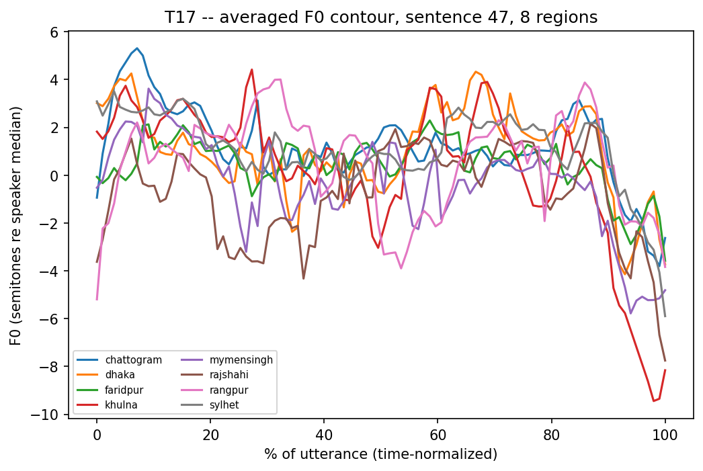

*f0_contour_8regions_sentence47.png*

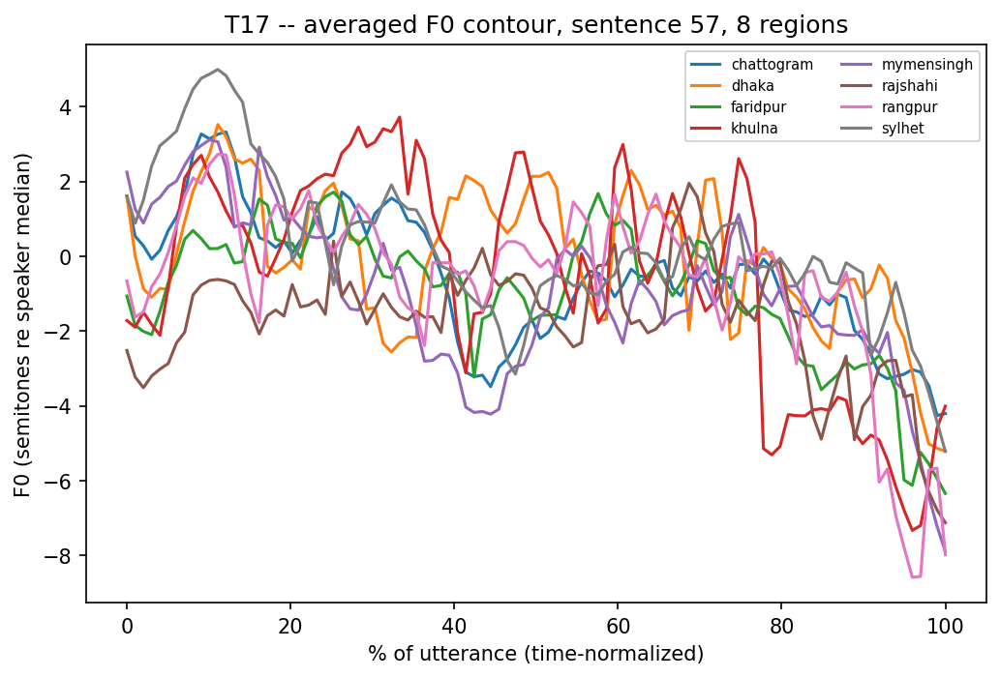

*f0_contour_8regions_sentence57.png*

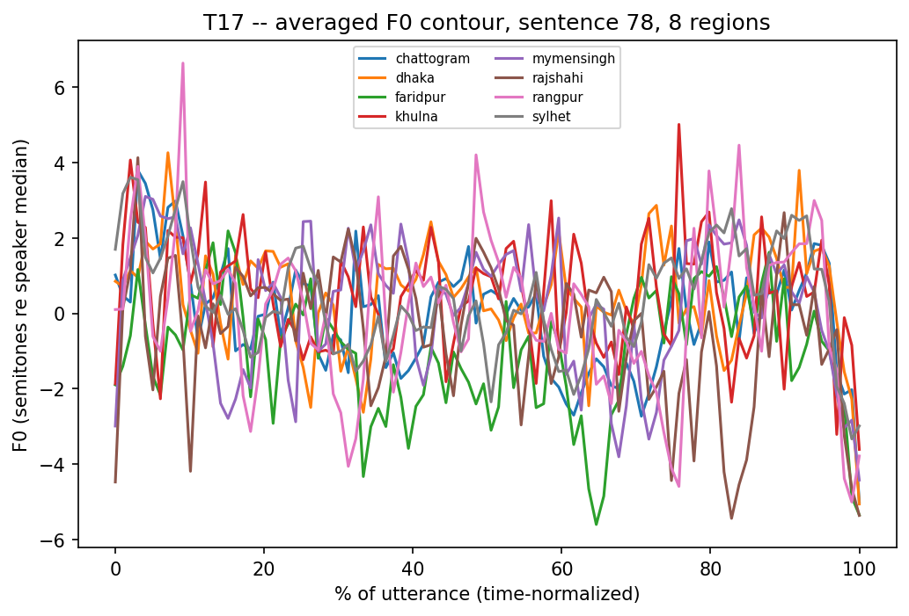

*f0_contour_8regions_sentence78.png*

### F0 summary features by region

| region     |   f0_range_st |   f0_initial_st |   f0_final_st |   final_slope_st |   n_peaks |
|:-----------|---------------:|-----------------:|---------------:|-------------------:|-----------:|
| chattogram |        15.968 |           1.009 |        -3.678 |           -0.173 |    20.386 |
| dhaka      |        17.044 |           0.798 |        -4.064 |           -0.202 |    20.689 |
| faridpur   |        16.088 |           0.414 |        -5.956 |           -0.249 |    20.7   |
| khulna     |        18.555 |          -1.024 |        -4.4   |           -0.207 |    19.534 |
| mymensingh |        18.336 |           0.174 |        -4.806 |           -0.216 |    20.934 |
| rajshahi   |        17.394 |          -0.741 |        -5.792 |           -0.23  |    20.696 |
| rangpur    |        19.124 |          -0.542 |        -5.494 |           -0.231 |    21.05  |
| sylhet     |        17.039 |           1.739 |        -4.156 |           -0.217 |    20.646 |

### Contour distance matrix (feeds T18)

|            |   chattogram |   dhaka |   faridpur |   khulna |   mymensingh |   rajshahi |   rangpur |   sylhet |
|:-----------|-------------:|--------:|-----------:|---------:|-------------:|-----------:|----------:|---------:|
| chattogram |      nan     |   1.225 |      1.165 |    1.493 |        1.319 |      1.381 |     1.328 |    1.078 |
| dhaka      |        1.225 | nan     |      1.339 |    1.581 |        1.416 |      1.509 |     1.468 |    1.217 |
| faridpur   |        1.165 |   1.339 |    nan     |    1.514 |        1.284 |      1.26  |     1.276 |    1.138 |
| khulna     |        1.493 |   1.581 |      1.514 |  nan     |        1.645 |      1.678 |     1.635 |    1.509 |
| mymensingh |        1.319 |   1.416 |      1.284 |    1.645 |      nan     |      1.482 |     1.445 |    1.255 |
| rajshahi   |        1.381 |   1.509 |      1.26  |    1.678 |        1.482 |    nan     |     1.476 |    1.363 |
| rangpur    |        1.328 |   1.468 |      1.276 |    1.635 |        1.445 |      1.476 |   nan     |    1.333 |
| sylhet     |        1.078 |   1.217 |      1.138 |    1.509 |        1.255 |      1.363 |     1.333 |  nan     |

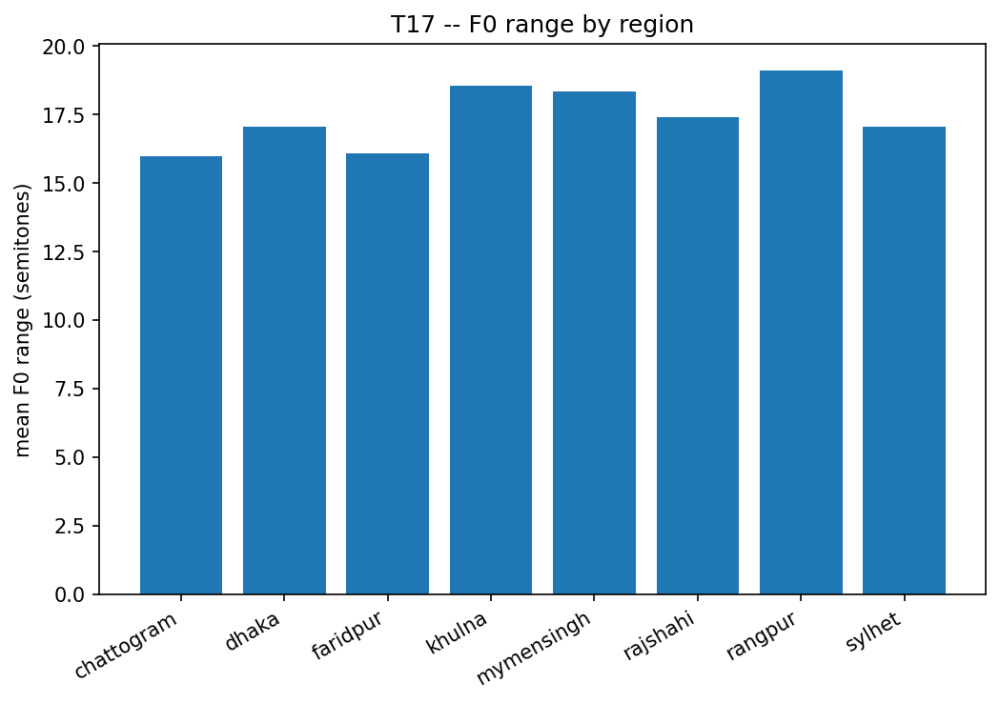

*Mean F0 range by region.*

### For the paper

S7.6. One contour figure goes in the main paper as the visual argument for parallelism.

---

## D6 — T18: Fused Phonetic Distance Matrix

Fused 7 feature blocks (phone_duration, rhythm, vowel_formants, vowel_space_area, pillai, sibilant_cog, f0) -> 74 standardized features across 8 regions. Cophenetic correlation of the Ward dendrogram: **0.6826**.

### Feature blocks used

- `phone_duration`: 40 feature(s)
- `rhythm`: 7 feature(s)
- `vowel_formants`: 16 feature(s)
- `vowel_space_area`: 1 feature(s)
- `pillai`: 4 feature(s)
- `sibilant_cog`: 1 feature(s)
- `f0`: 5 feature(s)

### Branch support (bootstrap over features)

| split                                                               |   support_pct |
|:--------------------------------------------------------------------|---------------:|
| mymensingh,faridpur,dhaka,chattogram,khulna,rajshahi,rangpur,sylhet |         100   |
| dhaka,khulna                                                        |          82.9 |
| mymensingh,rajshahi                                                 |          67.9 |
| faridpur,chattogram,rangpur,sylhet                                  |          57.7 |
| mymensingh,dhaka,khulna,rajshahi                                    |          54   |
| faridpur,rangpur                                                    |          38.3 |
| faridpur,chattogram,rangpur                                         |          26.4 |

### Feature-block sensitivity

| dropped_block    |   corr_with_full_matrix |
|:-----------------|--------------------------:|
| phone_duration   |                  0.511  |
| rhythm           |                  0.98   |
| vowel_formants   |                  0.9348 |
| vowel_space_area |                  0.9992 |
| pillai           |                  0.9956 |
| sibilant_cog     |                  1      |
| f0               |                  0.9911 |

### PCA

PC1 explains 34.0% of variance. Top-loading features:

| feature   |    PC1 |    PC2 |    PC3 |
|:----------|-------:|-------:|-------:|
| pctV      |  0.194 |  0.048 |  0.006 |
| O         |  0.192 |  0.042 | -0.065 |
| y         |  0.187 |  0.047 | -0.022 |
| a         |  0.185 |  0.044 | -0.04  |
| k         | -0.184 | -0.006 |  0.103 |
| p         | -0.183 | -0.059 |  0.024 |
| g         | -0.182 |  0.058 |  0.011 |
| ng        | -0.18  | -0.005 | -0.092 |
| Dh        | -0.179 | -0.009 | -0.024 |
| t         | -0.175 | -0.082 | -0.012 |

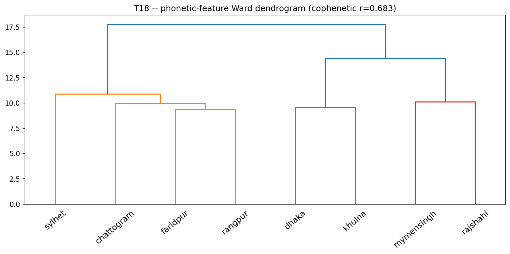

*Ward dendrogram of the fused phonetic distance matrix.*

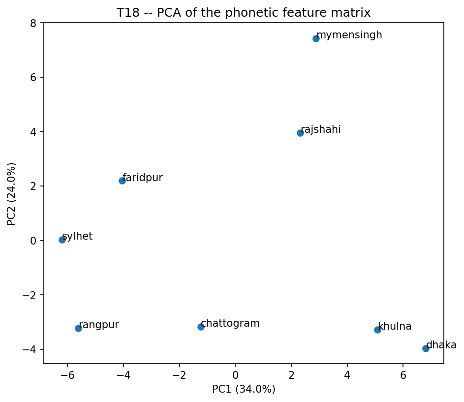

*PCA of the region x feature matrix.*

### For the paper

S7.7.

---

## D7 — T19: Convergence Test: Phonetic vs. Neural-Embedding Distance

Two independently-derived 8x8 region distance matrices -- one from opaque self-supervised embeddings (Part_C/C1), one from hand-measured phonetics (Part_D/D6) -- compared directly. This is the headline statistic of the paper.

### Mantel test

- Pearson r=0.138, p=0.4628 (10000 permutations)
- Spearman r=0.226, p=0.2327

### Procrustes

- Disparity (MDS 2D alignment residual): **0.5513** (lower = better geometric agreement)

### Per-region agreement

| region     |   row_correlation |
|:-----------|--------------------:|
| chattogram |             0.964 |
| rajshahi   |             0.955 |
| mymensingh |             0.946 |
| khulna     |             0.937 |
| dhaka      |             0.932 |
| sylhet     |             0.927 |
| faridpur   |             0.917 |
| rangpur    |             0.898 |

### Three-way check against geography (T10)

- geography vs. embedding: r=0.175, p=0.3293
- geography vs. phonetic: r=-0.197, p=0.3762

### Figures

*Neural vs. phonetic dendrograms side by side.*

*MDS + Procrustes overlay -- MAIN PAPER FIGURE.*

### For the paper

S7.8 and the abstract. This is the headline figure.
