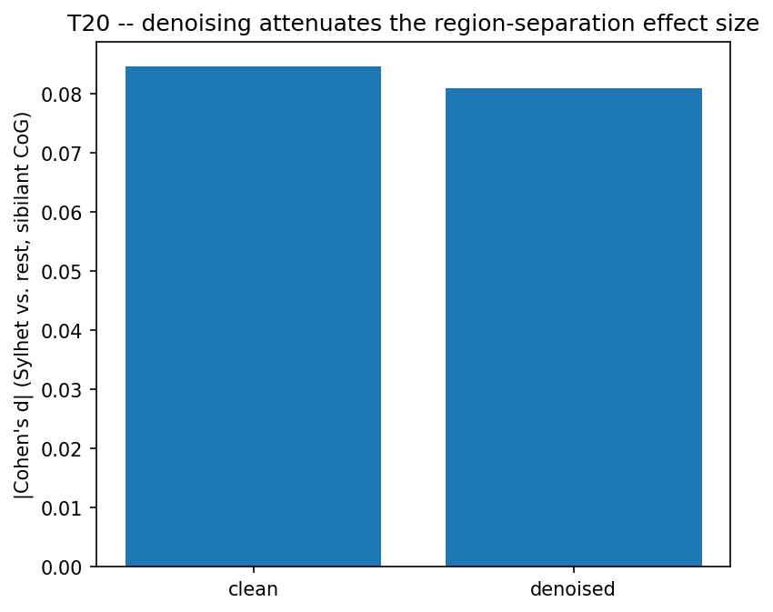
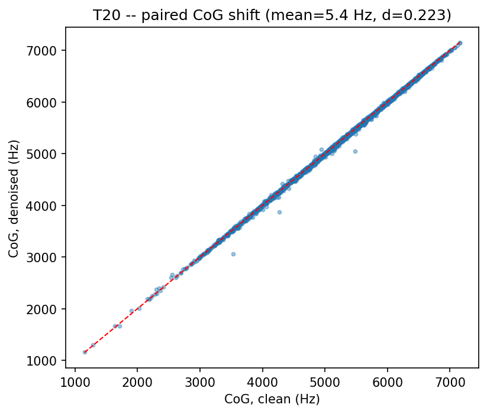

# T20 -- Denoising Sanity Check

Paired comparison on 2000 sibilant tokens: mean CoG shift after denoising = **5.4 Hz** (paired t p=7.24e-23, Wilcoxon p=4.63e-42, Cohen's d=0.223).

## Key demonstration: denoising attenuates the region-separation effect

| metric                      |   clean |   denoised |   pct_attenuation |
|:----------------------------|--------:|-----------:|------------------:|
| sylhet_vs_rest_cog_cohens_d |  -0.085 |     -0.081 |               4.3 |

*Effect size before/after denoising -- the argument in one number.*

*Paired CoG shift scatter.*

## Noisereduce parameters

library defaults (thesis params not recoverable)

## For the paper

S7.1 methods footnote + appendix. Settles why this paper does not denoise.
